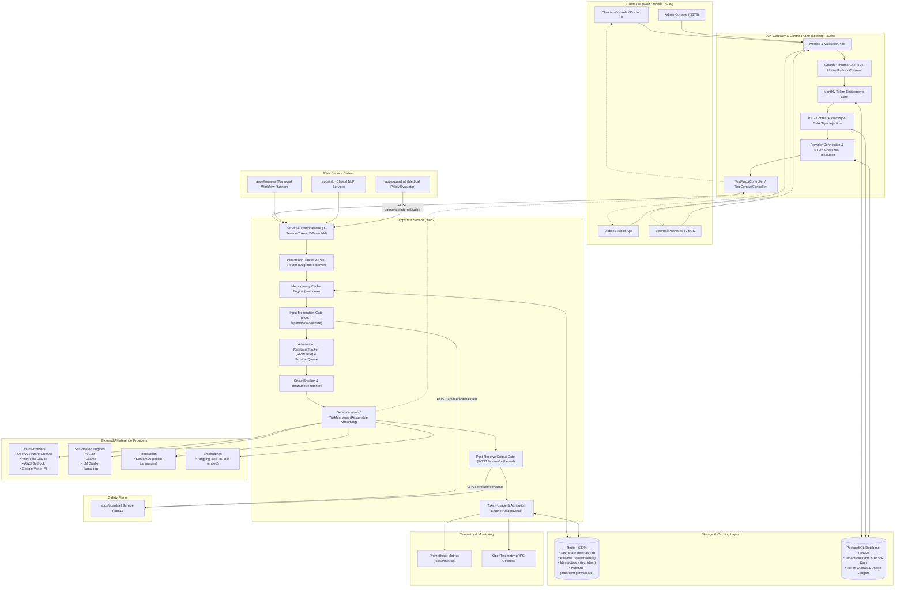
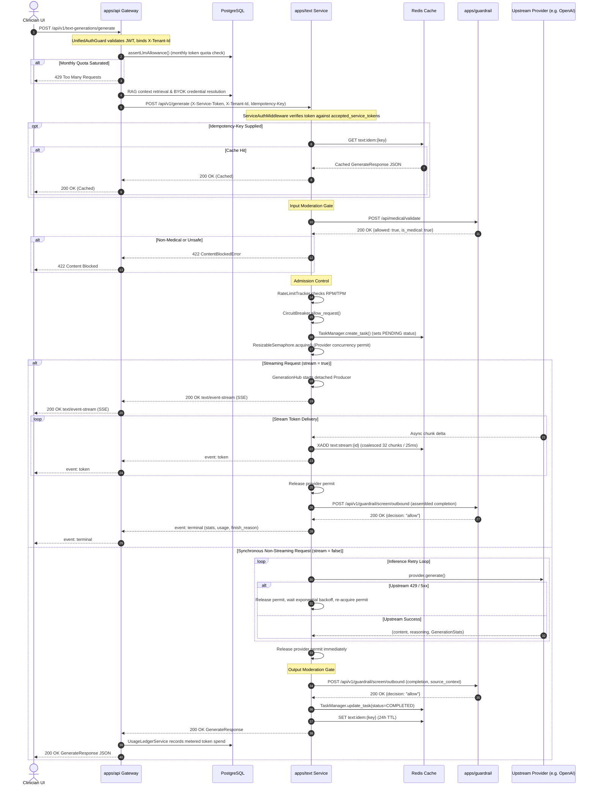
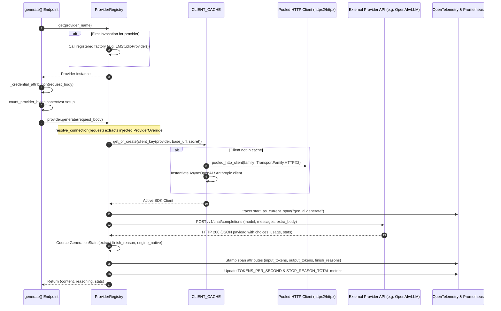
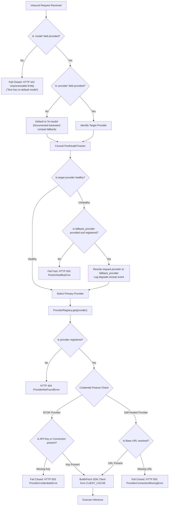
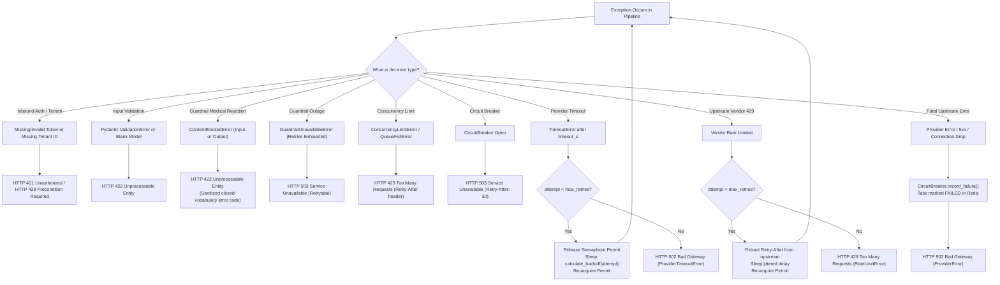
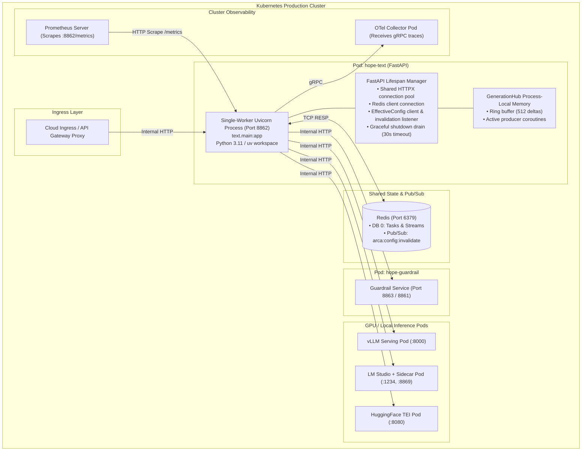

# LLM Service Architecture & Visual Specifications (`apps/text`)

This document provides architectural blueprints and visual flowcharts for the HOPE Text Generation & LLM Service (`apps/text`). Every diagram strictly reflects actual codebase implementations.

---

## 1. High-Level System Architecture

`apps/text` is an asynchronous, high-throughput Python/FastAPI microservice running on port `8862`. It serves as the platform's multi-provider LLM gateway, summarization engine, translation broker, and embeddings provider.

---

## 2. Internal Component Architecture (`apps/text`)

This diagram details the internal modular structure inside `apps/text/src/text`.

```mermaid
flowchart TD
    subgraph IngressLayer["1. Ingress & Security Layer"]
        AuthMiddleware["ServiceAuthMiddleware (api/middleware/auth.py)\n• X-Service-Token constant-time verification\n• X-Tenant-Id binding (428 if missing)\n• EXEMPT_PATHS bypass (/health, /metrics)"]
        ExceptionHandlers["Exception Handlers (core/exception_handlers.py)\n• Maps domain exceptions to standard JSON ErrorResponse"]
    end

    subgraph RoutingLayer["2. Routing & Admission Control"]
        PoolRouterMod["Pool Router (services/pool_router.py)\n• Re-routes from unhealthy pool to fallback_provider"]
        HealthTracker["PoolHealthTracker (services/pool_health.py)\n• In-memory provider status cache updated by /health"]
        Idempotency["Idempotency Filter (api/endpoints/generate.py)\n• Redis text:idem:{key} 24h cache check"]
        RateLimiterMod["RateLimitTracker (services/rate_limiter.py)\n• Rolling-window RPM & TPM tracker"]
        QueueMod["ProviderQueue (services/provider_queue.py)\n• Priority queue for throttled requests"]
        CircuitBreakerMod["CircuitBreaker (services/circuit_breaker.py)\n• CLOSED -> OPEN -> HALF_OPEN states"]
        SemaphoreMod["ResizableSemaphore (services/resizable_semaphore.py)\n• Live-adjustable concurrent permit limiter"]
    end

    subgraph SafetyLayer["3. Clinical Safety Plane"]
        ExtGuardrail["ExternalGuardrailClient (services/external_guardrail.py)\n• Input: POST /api/medical/validate (Fail-Closed)\n• Output: POST /api/v1/guardrail/screen/outbound"]
        OutputGateMod["Output Gate (services/output_gate.py)\n• Toxicity, refusal, and PII-leakage validation"]
        JudgeGuard["Judge Scope Guard (services/judge_guard.py)\n• assert_not_in_judge_scope cycle tripwire"]
    end

    subgraph HubLayer["4. Execution Hub & Task Lifecycle"]
        GenHub["GenerationHub (routing/hub.py)\n• Producer-Subscriber detached execution\n• Gapless resumption via in-memory ring buffer"]
        TaskMgr["TaskManager (services/task_manager.py)\n• Redis TaskState hash updates (Lua scripts)\n• Redis Stream chunk appender (XADD)"]
        StreamingProd["Streaming Producer (routing/streaming.py)\n• Batch chunk coalescing (32 chunks / 25ms)\n• Wall-clock cancel flag polling"]
        ShutdownMgr["ShutdownManager (services/shutdown_manager.py)\n• Active task counter & graceful 30s drain"]
    end

    subgraph ProviderLayer["5. Inference Adapters & Pooling"]
        Registry["ProviderRegistry (providers/base.py)\n• Lazy factory-driven provider instantiation"]
        ConnectionPool["Transport Pool (providers/pool.py)\n• HTTPX / HTTPX2 pooled AsyncClient\n• Wire byte counter (count_provider_bytes)"]
        ClientCache["Client Cache (providers/clients.py)\n• Isolated by (provider, base_url, credential)"]
        CloudAdapters["Cloud Adapters:\n• OpenAIProvider\n• AzureOpenAIProvider\n• AnthropicProvider\n• BedrockProvider\n• VertexProvider"]
        LocalAdapters["Self-Hosted Adapters:\n• VllmProvider\n• OllamaProvider\n• LMStudioProvider\n• LlamaCppProvider\n• OpenAICompatProvider"]
        SpecializedAdapters["Specialized:\n• SarvamTranslateProvider\n• TeiEmbedProvider"]
    end

    subgraph ControlPlane["6. Dynamic Control Plane"]
        EffConfig["EffectiveConfigClient (core/effective_config.py)\n• Pulls GET /internal/effective-config?service=text\n• 60s TTL jittered cache & negative caching\n• Subscribes to Redis arca:config:invalidate"]
        LimitsEngine["Runtime Limits (services/runtime_limits.py)\n• Live updates to Semaphores, Breakers & RateLimiters"]
    end

    IngressLayer --> RoutingLayer
    RoutingLayer --> SafetyLayer
    SafetyLayer --> HubLayer
    HubLayer --> ProviderLayer
    ControlPlane --> RoutingLayer
    ControlPlane --> SafetyLayer
    ControlPlane --> ProviderLayer
```

---

## 3. End-to-End Request Sequence Diagram

---

## 4. LLM Inference Sequence Diagram (Provider Layer Detail)

This diagram focuses strictly on the internal provider adapter lifecycle, pooled connection management, and credential resolution during `provider.generate()`.

---

## 5. Provider Selection and Routing Flow

---

## 6. Error-Handling and Resilience Flow

---

## 7. Deployment Architecture

