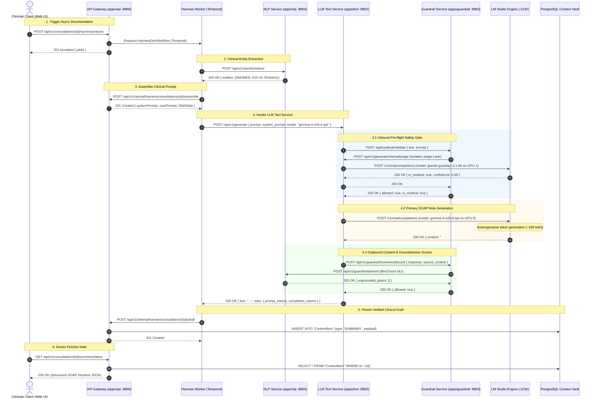

# HOPE LLM Service End-to-End Architecture & API Interaction Specification

This document provides the complete end-to-end architectural sequence, microservice boundaries, hardware pin mappings, and exact API route transitions for the HOPE clinical documentation generation service (`apps/text`) and its surrounding ecosystem.

---

## 1. System Topology & Hardware Pinning

The system operates across a Kubernetes cluster backed by dual dedicated NVIDIA GPUs:

```
┌─────────────────────────────────────────────────────────────────────────────────────────┐
│                                   KUBERNETES CLUSTER                                    │
│                                                                                         │
│  [API Gateway]             [Harness Worker]              [NLP Service]                  │
│  apps/api (:8866)          hope-harness-worker           apps/nlp (:8864)               │
│  Auth, Routes, Ingress     Temporal Orchestrator         Entity Extraction & NLI        │
│                                                                                         │
│  [Text Service]            [Guardrail Service]           [Context Vault DB]             │
│  apps/text (:8862)         apps/guardrail (:8863)        PostgreSQL + pgvector          │
│  LLM Gateway & Judge Lane  Safety & Medical Policy       Clinical Session State         │
└─────────────────────────────────────────┬───────────────────────────────────────────────┘
                                          │
                        ┌─────────────────┴─────────────────┐
                        │   LM STUDIO ENGINE (:1234)        │
                        ├─────────────────┬─────────────────┤
                        │  GPU 0 (16 GB)  │  GPU 1 (16 GB)  │
                        │  ─────────────  │  ─────────────  │
                        │  gemma-4-e2b    │  granite-       │
                        │  (Note Gen)     │  guardian-4.1   │
                        │                 │  (Safety Judge) │
                        └─────────────────┴─────────────────┘
```

---

## 2. End-to-End Sequence & API Interaction Diagram



---

## 3. Complete Microservice API Route Directory

|      Step      |      Source Component      |      Target Component      |                                   HTTP Method & Exact Path                                   | Headers & Auth                            | Request Payload Purpose                                                            | Response / Downstream Transition                                                                                         |
| :------------: | :-------------------------: | :-------------------------: | :-------------------------------------------------------------------------------------------: | :---------------------------------------- | :--------------------------------------------------------------------------------- | :----------------------------------------------------------------------------------------------------------------------- |
|  **1**  |   **Clinician UI**   |    **API Gateway**    |                       `POST /api/v1/consultations/{id}/summary/async`                       | `Authorization: Bearer <JWT>`           | Initiates async documentation generation.                                          | Returns `201 Accepted` with `{ jobId }`. Triggers Temporal workflow.                                                 |
|  **2**  |  **Harness Worker**  |    **NLP Service**    |                   `POST http://hope-nlp-svc:8864/api/v1/classify/tokens`                   | `X-Tenant-Id`, `X-Service-Token`      | Raw conversation transcript text.                                                  | Returns `200 OK` with structured clinical entities (SNOMED-CT, ICD-10).                                                |
|  **3**  |  **Harness Worker**  |    **API Gateway**    | `POST http://hope-api-gateway-svc:8866/api/v1/internal/harness/consultations/{id}/assemble` | `X-Service-Token`                       | Consultation ID and extracted entity tokens.                                       | Returns `201 Created` with formatted `systemPrompt`, `userPrompt`, and clinician **DNA Writing Style**.      |
|  **4**  |  **Harness Worker**  | **LLM Text Service** |                      `POST http://hope-text-svc:8862/api/v1/generate`                      | `X-Tenant-Id`, `X-Service-Token`      | Body: `{ prompt, system_prompt, model: "gemma-4-e2b-it-qat", max_tokens: 4096 }` | Hands off assembled prompt to `apps/text` to coordinate generation and validation.                                     |
| **4.1a** | **LLM Text Service** | **Guardrail Service** |                 `POST http://hope-guardrail-svc:8863/api/medical/validate`                 | `X-Tenant-Id`, `X-Service-Token`      | Body: `{ text: "<prompt>", include_reasoning: false }`                           | **Inbound Gate:** Evaluates whether input contains authentic medical dialog before generating.                     |
| **4.1b** | **Guardrail Service** | **LLM Text Service** |               `POST http://hope-text-svc:8862/api/v1/generate/internal/judge`               | `X-Tenant-Id`, `X-Service-Token`      | Body: `{ prompt, model: "granite-guardian-4.1-8b" }`                             | **Isolated Judge Lane:** Guardrail delegates model inference back to `apps/text` on its own dedicated semaphore. |
| **4.1c** | **LLM Text Service** | **LM Studio (GPU 1)** |                    `POST http://hope-lmstudio:1234/v1/chat/completions`                    | None (Internal localhost/cluster network) | Body: `{ model: "granite-guardian-4.1-8b", temperature: 0.05, max_tokens: 300 }` | Executes IBM Granite Guardian on **GPU 1** to output a deterministic JSON verdict.                                 |
| **4.2** | **LLM Text Service** | **LM Studio (GPU 0)** |                    `POST http://hope-lmstudio:1234/v1/chat/completions`                    | None (Internal localhost/cluster network) | Body: `{ model: "gemma-4-e2b-it-qat", max_tokens: 4096, temperature: 0.2 }`      | **Primary Note Inference:** Runs Gemma 4 on **GPU 0** at ~190 tok/s to synthesize the SOAP note.             |
| **4.3a** | **LLM Text Service** | **Guardrail Service** |           `POST http://hope-guardrail-svc:8863/api/v1/guardrail/screen/outbound`           | `X-Tenant-Id`, `X-Service-Token`      | Body: `{ response: "<note>", source_context: "<transcript>" }`                   | **Outbound Gate:** Checks generated note for hallucinations, contraindications, and PII leakage.                   |
| **4.3b** | **Guardrail Service** |    **NLP Service**    |                   `POST http://hope-nlp-svc:8864/api/v1/guard/entailment`                   | `X-Tenant-Id`, `X-Service-Token`      | Body: `{ premise: "<transcript>", hypothesis: "<sentence>" }`                    | Uses MiniCheck NLI to verify that every medical statement in the note is grounded in the transcript.                     |
|  **5a**  |  **Harness Worker**  |    **API Gateway**    |  `POST http://hope-api-gateway-svc:8866/api/v1/internal/harness/consultations/{id}/draft`  | `X-Service-Token`                       | Body: `{ summary: "<note>", sections: [...] }`                                   | Transmits the verified draft and usage stats to the Gateway.                                                             |
|  **5b**  |    **API Gateway**    |    **PostgreSQL**    |                              `INSERT INTO "ContextItem" (...)`                              | Direct connection                         | Serializes and saves the note in PostgreSQL under `type: SUMMARY`.               |                                                                                                                          |
|  **6**  |   **Clinician UI**   |    **API Gateway**    |                       `GET /api/v1/consultations/{id}/summary/latest`                       | `Authorization: Bearer <JWT>`           | Consultation ID                                                                    | Gateway queries PostgreSQL and delivers the formatted SOAP note JSON to the doctor.                                      |

---

## 4. Subsystem Deep Dives

### 4.1 Inbound Gate: Medical Context Validation

- **Trigger**: Called by `apps/text` before sending the prompt to the primary LLM.
- **Microservices**: `apps/text` ➔ `apps/guardrail` ➔ `apps/text/internal/judge` ➔ LM Studio (GPU 1).
- **Model**: `granite-guardian-4.1-8b` (IBM Granite Guardian 4-bit GGUF, ~4.9 GB VRAM).
- **Fail Posture**: **Fail-Closed**. If Guardrail is unreachable or times out, `apps/text` raises `503 GUARDRAIL_UNAVAILABLE`. It never allows an unverified PHI prompt through.

### 4.2 Primary Note Generation & Reasoning Budget Protection (TASK-1069)

- **Trigger**: Triggered once Inbound Validation passes.
- **Microservices**: `apps/text` ➔ LM Studio (GPU 0).
- **Model**: `gemma-4-e2b-it-qat` via llama.cpp GGUF server.
- **Protection Guard**: Because Gemma 4 is a thinking model, `apps/text` monitors completion output. If the model burns its entire 4,096-token allocation purely on chain-of-thought `<thought>` reasoning without producing a note, it retries once with an elevated cap. If it exhausts again, it cleanly returns `422 REASONING_BUDGET_EXHAUSTED`.

### 4.3 Outbound Gate: Anti-Hallucination & Groundedness Checking

- **Trigger**: Executed immediately after note generation.
- **Microservices**: `apps/text` ➔ `apps/guardrail` ➔ `apps/nlp`.
- **Model**: MiniCheck / DeBERTa Natural Language Inference (NLI).
- **Mechanism**: Splits the generated note into sentences and evaluates:
  $$
  \text{Premise: Transcript} \implies \text{Hypothesis: Note Sentence}
  $$

  If a claim is not entailed by the conversation, it is tagged with character offsets (`flagged_spans`) and displayed with an audit flag on the doctor's screen.

### 4.4 Note Retrieval & Presentation

- **Trigger**: Clinician loads consultation.
- **Latency**: Stays constant at **~550ms – 720ms** across all token tiers because it performs an indexed database read and JSON DTO transformation.

---

## 5. Failure Posture & HTTP Status Codes

| Error Condition                            | HTTP Status | Error Token                     | System Behavior                                                      |
| :----------------------------------------- | :---------: | :------------------------------ | :------------------------------------------------------------------- |
| **Guardrail Service Down / Timeout** |   `503`   | `GUARDRAIL_UNAVAILABLE`       | Fail-closed: generation aborted; retryable platform error.           |
| **Input Lacks Medical Context**      |   `422`   | `CONTENT_BLOCKED_NOT_MEDICAL` | Request rejected; clinician notified text is non-clinical.           |
| **Model Token Budget Exhausted**     |   `422`   | `REASONING_BUDGET_EXHAUSTED`  | Model spent budget in reasoning loops; protects DB from blank notes. |
| **Consultation Access Denied**       |   `403`   | `TENANT_ACCESS_DENIED`        | Cross-tenant boundary protection enforced at Gateway.                |
| **Note Generation Still In Flight**  |   `404`   | `SUMMARY_NOT_YET_AVAILABLE`   | Async job still processing in Temporal queue.                        |
