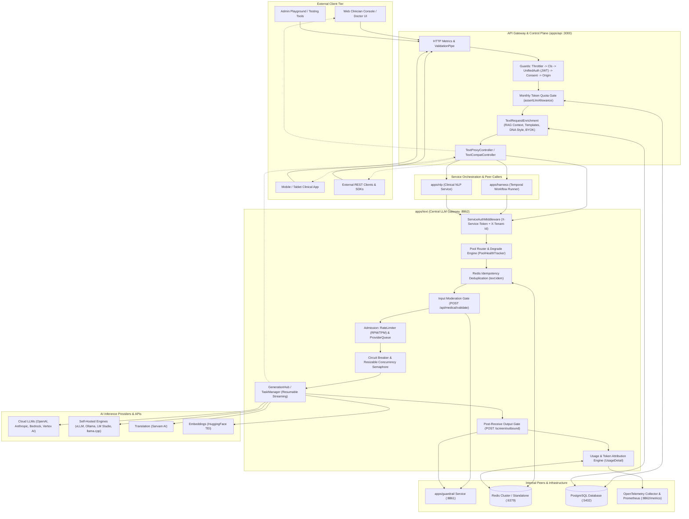
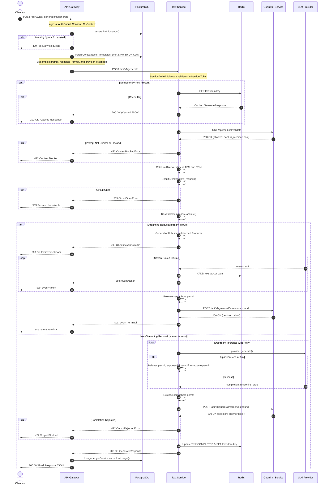
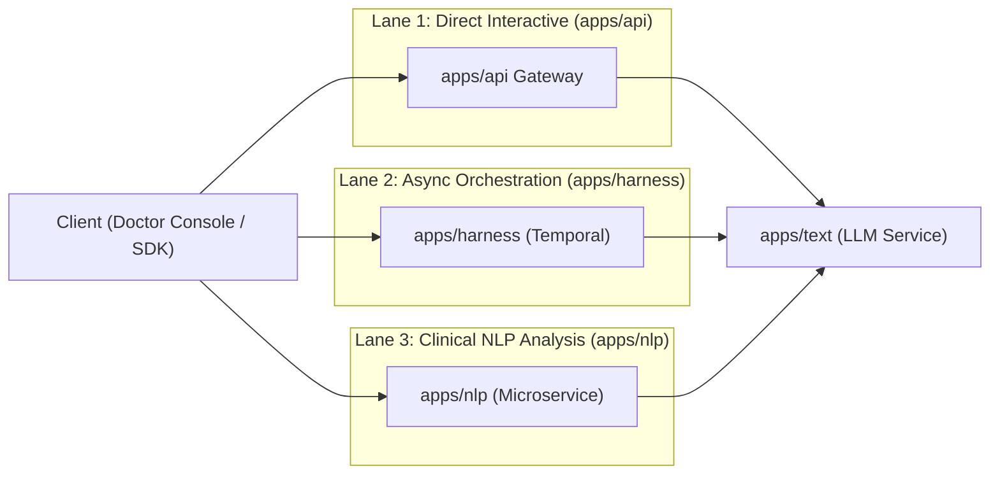

# End-to-End LLM Service Architecture & Client Invocation Flow

This document details the complete end-to-end architecture of Project Hope's **Text Generation & LLM Service** (`apps/text`), starting from the **External Client Tier** through the **API Gateway** (`apps/api`), orchestrators (`apps/harness`), domain microservices (`apps/nlp`), the LLM inference service (`apps/text`), medical guardrails (`apps/guardrail`), and external AI providers.

---

## 1. End-to-End System Topology (Client to LLM Provider)

---

## 2. Complete End-to-End Sequence Diagram (Client Invocation to LLM)

---

## 3. The 3 Invocation Pathways from the Client

Clients invoke the LLM infrastructure through three primary patterns:

### Lane 1: Direct Interactive Ingress (`Client -> apps/api -> apps/text`)

- **Trigger**: Doctor clicks "Generate Summary" or chats with the assistant in the clinical portal.
- **Protocol**: HTTPS `POST /api/v1/text-generations/generate` or `/api/smr/api/v1/summary/sync`.
- **Characteristics**: Low-latency, user-facing, real-time SSE token streaming (`stream: true`).
- **Resilience**: Client can resume disconnected streams via `GET /api/v1/text-generations/tasks/:taskId/stream` passing `Last-Event-ID`.

### Lane 2: Asynchronous Orchestration Ingress (`Client -> apps/api -> apps/harness -> apps/text`)

- **Trigger**: Doctor concludes an encounter, triggering a background post-consultation workflow.
- **Protocol**: Gateway schedules a **Temporal Workflow** on `apps/harness`.
- **Characteristics**: Non-streaming (`stream: false`), batch execution, multi-step autonomous agent loops.
- **Resilience**: Uses deterministic `Idempotency-Key` headers (`workflow_run:activity_id`). If an orchestrator worker restarts, `apps/text` replays from Redis cache without re-invoking or double-billing the upstream model.

### Lane 3: Domain NLP Ingress (`Client -> apps/api -> apps/nlp -> apps/text`)

- **Trigger**: Ingesting clinical notes, lab reports, or referral letters for semantic enrichment.
- **Protocol**: Gateway forwards document to `apps/nlp`.
- **Characteristics**: `apps/nlp` runs local NER and rule-based pipelines, but delegates **open-taxonomy medical intent classification and zero-shot topic labeling** (`nlp.intent` / `nlp.topic`) to `apps/text` via its internal `ExternalTextClient`.

---

## 4. Comprehensive Inventory of All API Calls

Below is the complete inventory of all API calls across the entire chain:

| Source                       | Destination        | Protocol & Method | Route / Endpoint                                       | Purpose & Payload                                                                                                             |
| :--------------------------- | :----------------- | :---------------- | :----------------------------------------------------- | :---------------------------------------------------------------------------------------------------------------------------- |
| **Client**             | `apps/api`       | HTTPS `POST`    | `/api/v1/text-generations/generate`                  | External client initiates text generation (sync JSON or SSE stream initiation).                                               |
| **Client**             | `apps/api`       | HTTPS `GET`     | `/api/v1/text-generations/tasks/:taskId/stream`      | Client subscribes to long-lived SSE stream with `Last-Event-ID` cursor resumption.                                          |
| **Client**             | `apps/api`       | HTTPS `POST`    | `/api/smr/api/v1/summary/sync`                       | Clinical encounter summarization endpoint; maps session context to schema prompts.                                            |
| **`apps/api`**       | PostgreSQL         | TCP / Prisma      | Queries on `db_main`                                 | Quota check (`assertLlmAllowance`), context retrieval, DNA writing styles, BYOK key resolution.                             |
| **`apps/api`**       | `apps/text`      | HTTP `POST`     | `/api/v1/generate`                                   | Internal authenticated invocation with `X-Service-Token`, `X-Tenant-Id`, and provider overrides.                          |
| **`apps/harness`**   | `apps/text`      | HTTP `POST`     | `/api/v1/generate`                                   | Temporal activity invocation with deterministic `Idempotency-Key` for crash recovery.                                       |
| **`apps/nlp`**       | `apps/text`      | HTTP `POST`     | `/api/v1/generate`                                   | Microservice peer call for open-taxonomy clinical intent and topic classification.                                            |
| **`apps/text`**      | `apps/guardrail` | HTTP `POST`     | `/api/medical/validate`                              | **Input Gate**: Evaluates prompt clinical relevance (`is_medical`) and policy before generation. Fail-closed.         |
| **`apps/text`**      | `apps/guardrail` | HTTP `POST`     | `/api/v1/guardrail/screen/outbound`                  | **Output Gate**: Post-generation screening of completions for toxicity, refusal, containment-echo, and PII leaks.       |
| **`apps/guardrail`** | `apps/text`      | HTTP `POST`     | `/generate/internal/judge`                           | **Safety Evaluation**: Guardrail calls Text's isolated judge lane to run LLM evaluations. Recursion tripwire protected. |
| **`apps/text`**      | `apps/api`       | HTTP `GET`      | `/internal/v1/effective-config/text`                 | Control plane pull: pulls live runtime limits, lane budgets, and tenant moderation postures.                                  |
| **`apps/text`**      | `apps/api`       | HTTP `POST`     | `/internal/v1/service-release`                       | Self-registration of build info, version, and deployment environment.                                                         |
| **`apps/text`**      | Redis              | RESP / aioredis   | `text:idem:*`, `text:task:*`, `text:stream:*`    | Deduplication cache (24h TTL), task persistence, stream replay buffering (`XADD`), cancellation checks.                     |
| **`apps/text`**      | Cloud LLMs         | HTTPS `POST`    | Vendor REST / SDK (OpenAI, Anthropic, Bedrock, Vertex) | Upstream model inference with pooled HTTP connections, retry math, and token counting.                                        |
| **`apps/text`**      | Local LLMs         | HTTP `POST`     | Local engines (vLLM, Ollama, LM Studio, llama.cpp)     | Self-hosted model inference with connection routing.                                                                          |
| **`apps/text`**      | Sarvam AI          | HTTPS `POST`    | `{base_url}/translate`                               | BYOK translation for Indian languages (chunked into 900-char parts).                                                          |
| **`apps/text`**      | TEI                | HTTP `POST`     | `{base_url}/embed`                                   | Native HuggingFace text-embeddings-inference vector generation.                                                               |
| **`apps/text`**      | OTel / Prom        | gRPC / HTTP       | Exporter endpoint & `/metrics`                       | Distributed traces, Prometheus latency metrics, tokens/second, and TTFT gauges.                                               |

---

## 5. Transition Conditions & Handover Matrix

| Step                                     | Component                                                        | Transition & Handover Trigger                                                                                              | Failure / Degradation Posture                                                                                       |
| :--------------------------------------- | :--------------------------------------------------------------- | :------------------------------------------------------------------------------------------------------------------------- | :------------------------------------------------------------------------------------------------------------------ |
| **1. Client Gateway Auth & Quota** | `apps/api` (`UnifiedAuthGuard`, `assertLlmAllowance`)      | Validates JWT/API Key, binds tenant to CLS context, verifies monthly token entitlement budget.                             | Rejects with `401 Unauthorized` or `429 Too Many Requests` (Quota exhausted).                                   |
| **2. Prompt Assembly & BYOK**      | `apps/api` (`TextRequestEnrichmentService`)                  | Fetches transcripts, notes, prompt template, and doctor writing style. Resolves tenant BYOK credentials.                   | Rejects with `404 Not Found` if context item belongs to another tenant; fails closed if model unresolvable.       |
| **3. Text Ingress & Pool Router**  | `apps/text` (`ServiceAuthMiddleware`, `PoolHealthTracker`) | Validates `X-Service-Token`. Verifies target provider health; swaps to `fallback_provider` if target unhealthy.        | `401 Unauthorized` on bad token; `503 PoolUnhealthyError` if unhealthy and no fallback configured.              |
| **4. Redis Idempotency Check**     | `apps/text` (`text:idem:{key}`)                              | Checks Redis cache for deterministic `Idempotency-Key`. On hit, replays cached result.                                   | Cache miss continues to generation. Cache read errors degrade to normal generation (never block request).           |
| **5. Input Moderation Gate**       | `apps/guardrail` (`POST /api/medical/validate`)              | Validates prompt is medical content (`is_medical == True`) and safe.                                                     | Fails closed: non-clinical prompt raises `422 ContentBlockedError`. Guardrail down raises retryable `503`.      |
| **6. Admission Control**           | `apps/text` (`RateLimitTracker`, `ProviderQueue`)          | Checks token-bucket RPM/TPM limits. If saturated, enqueues request up to `queue_max_wait_s`.                             | Queue full or wait timeout raises `429 RateLimitError` / `503 QueueTimeoutError`.                               |
| **7. Circuit Breaker**             | `apps/text` (`CircuitBreaker`)                               | Checks provider error state. Proceeds if `CLOSED` or `HALF_OPEN`.                                                      | If `OPEN`, fails fast with `503 CircuitOpenError` (Retry-After: 30s) to protect upstream engine.                |
| **8. Concurrency Permit**          | `apps/text` (`ResizableSemaphore`)                           | Acquires in-flight concurrency permit (bounded pool).                                                                      | Semaphore wait timeout (30s) raises `503 ConcurrencyLimitError`.                                                  |
| **9. Upstream Inference**          | Provider SDK / Transport                                         | Dispatches HTTP/streaming call to upstream model engine. Hands permit back during retry backoffs.                          | Upstream 429/5xx retries with jittered exponential backoff and `Retry-After`. 4xx client errors fail immediately. |
| **10. Permit Release**             | Concurrency Permit Release                                       | **Drops concurrency permit immediately upon receiving completion**, before output screening.                         | Prevents slow outbound moderation checks from starving provider lane concurrency for other tenants.                 |
| **11. Output Moderation Gate**     | `apps/guardrail` (`POST /screen/outbound`)                   | Screens model completion for toxicity, refusal, containment-echo, and PII leakage against prompt.                          | Blocked output raises `422 OutputRejectedError`; task marked `FAILED`. Completion is never returned or cached!  |
| **12. Client Return & Metering**   | Gateway & Client                                                 | Stores response in Redis idempotency cache (24h TTL), writes usage to `IUsageLedgerService`, returns JSON/SSE to Client. | Idempotency write failures are swallowed so successfully generated & billed results are never lost.                 |
