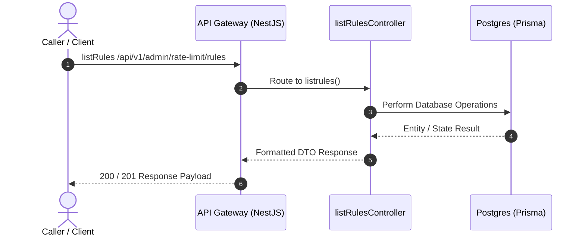

# Listrules Flow (`admin-listrules`)

> **Interactive Diagram:** [`admin-listrules.html`](admin-listrules.html)  
> **Source Repository:** [ArcaAI/project-hope](https://github.com/ArcaAI/project-hope/tree/dev-2.2)  
> **Target Branch:** `dev-2.2`  
> **Verified Revision:** `8cb2e5e8e6bbddf5ee7c676782ebb5ad683c23a0`

---

## 1. Overview & API Endpoints

This document provides architectural documentation and code references for the **listRules** workflow registered in the API Gateway.

- **Primary Route:** `/api/v1/admin/rate-limit/rules`
- **Handler Method:** [`rate-limit-admin.controller.ts`](https://github.com/ArcaAI/project-hope/tree/dev-2.2/apps/api/src/modules/admin-rate-limit/rate-limit-admin.controller.ts#L134-L135)
- **Source File:** [`src/modules/admin-rate-limit/rate-limit-admin.controller.ts`](https://github.com/ArcaAI/project-hope/tree/dev-2.2/apps/api/src/modules/admin-rate-limit/rate-limit-admin.controller.ts#L134-L135)
- **Functional Summary:** List rate-limit rules.

---

## 2. Sequence Diagram Architecture

Open the interactive HTML diagram [`admin-listrules.html`](admin-listrules.html) to view full SVG lifelines, participant activations, and inspect the code evidence passport beacons.

---

## 3. Code References & Verification (dev-2.2)

| Participant / Layer | Local Repository Path | Source Method / Symbol | GitHub Blob URL (`dev-2.2`) |
|---|---|---|---|
| API Gateway | `apps/api/src/main.ts` | Bootstrap & Routing | [main.ts#L1](https://github.com/ArcaAI/project-hope/blob/dev-2.2/apps/api/src/main.ts#L1) |
| Controller | `src/modules/admin-rate-limit/rate-limit-admin.controller.ts` | `listRules` (L134-L135) | [rate-limit-admin.controller.ts#134-L135](https://github.com/ArcaAI/project-hope/tree/dev-2.2/apps/api/src/modules/admin-rate-limit/rate-limit-admin.controller.ts#L134-L135) |

---

## 4. Dependencies & Services

### Injected NestJS Services
- **Service1**
- **Service2**

### Data Stores & External Systems
- PostgreSQL (Main data)
- Redis (Cache, session context)
- LLM Provider (OpenAI/Anthropic/Local)

---

## 5. HTTP Status Codes & Error Handling

| Status Code | Description | Condition |
|---|---|---|
| `200 OK` / `201 Created` / `202 Accepted` | Success | Request validated, authenticated, and executed successfully. |
| `400 Bad Request` | Validation Error | Malformed body, missing required query/body fields. |
| `401 Unauthorized` | Auth Failure | Missing, expired, or malformed JWT Bearer token. |
| `403 Forbidden` | Access Denied | Insufficient permissions or tenant boundary violation. |
| `404 Not Found` | Not Found | Target entity or route does not exist. |
| `429 Too Many Requests` | Rate Limited | Request rate limit or token quota exceeded. |
| `500 Internal Error` | Server Failure | Unhandled exception or downstream dependency failure. |
