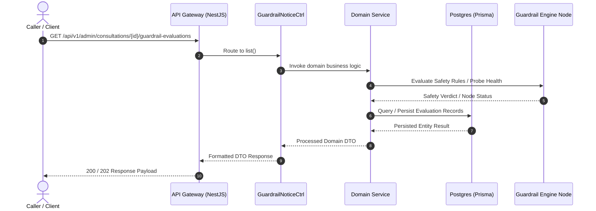

# Guardrail Notice & Clinical Safety Flags Flow (`guardrail-notice-flow`)

> **Interactive Diagram:** [`guardrail-notice-flow.html`](guardrail-notice-flow.html)  
> **Source Repository:** [ArcaAI/project-hope](https://github.com/ArcaAI/project-hope/tree/dev-2.2)  
> **Target Branch:** `dev-2.2`  
> **Verified Revision:** `8cb2e5e8e6bbddf5ee7c676782ebb5ad683c23a0`

---

## 1. Overview & API Endpoints

This document provides architectural documentation and code references for the **guardrail-notice-flow** workflow registered in the API Gateway.

- **Primary Route:** `GET /api/v1/admin/consultations/{id}/guardrail-evaluations`
- **Handler Method:** [`GuardrailNoticeCtrl.list()`](https://github.com/ArcaAI/project-hope/blob/dev-2.2/apps/api/src/modules/guardrail-notice/admin-guardrail-evaluation.controller.ts#L45-L60)
- **Source File:** [`apps/api/src/modules/guardrail-notice/admin-guardrail-evaluation.controller.ts`](https://github.com/ArcaAI/project-hope/blob/dev-2.2/apps/api/src/modules/guardrail-notice/admin-guardrail-evaluation.controller.ts#L45-L60)
- **Functional Summary:** Queries clinical safety notices, flagged content warnings, and guardrail verdicts on consultations.

---

## 2. Sequence Diagram Architecture

Open the interactive HTML diagram [`guardrail-notice-flow.html`](guardrail-notice-flow.html) to view full SVG lifelines, participant activations, and inspect the code evidence passport beacons.

---

## 3. Code References & Verification (dev-2.2)

| Participant / Layer | Local Repository Path | Source Method / Symbol | GitHub Blob URL (`dev-2.2`) |
|---|---|---|---|
| API Gateway | `apps/api/src/main.ts` | Bootstrap & Routing | [main.ts#L1](https://github.com/ArcaAI/project-hope/blob/dev-2.2/apps/api/src/main.ts#L1) |
| Controller | `apps/api/src/modules/guardrail-notice/admin-guardrail-evaluation.controller.ts` | `GuardrailNoticeCtrl.list()` (L45-60) | [admin-guardrail-evaluation.controller.ts#L45-L60](https://github.com/ArcaAI/project-hope/blob/dev-2.2/apps/api/src/modules/guardrail-notice/admin-guardrail-evaluation.controller.ts#L45-L60) |

---

## 4. Dependencies & Services

### Injected NestJS Services
- **AdminGuardrailEvaluationService**
- **UnifiedAuthGuard**
- **PrismaService**

### Data Stores & External Systems
- PostgreSQL (GuardrailNotice, ConsultationEvaluation tables)

---

## 5. HTTP Status Codes & Error Handling

| Status Code | Description | Condition |
|---|---|---|
| `200 OK` / `202 Accepted` | Success | Request validated, evaluated, and processed successfully. |
| `400 Bad Request` | Validation Error | Malformed body, missing required query/body fields. |
| `401 Unauthorized` | Auth Failure | Missing, expired, or malformed JWT Bearer token or service secret. |
| `403 Forbidden` | Access Denied | Insufficient permissions or tenant boundary violation. |
| `404 Not Found` | Not Found | Target evaluation entity or consultation does not exist. |
| `429 Too Many Requests` | Rate Limited | Request rate limit or token quota exceeded. |
| `500 Internal Error` | Server Failure | Unhandled exception or downstream dependency failure. |
