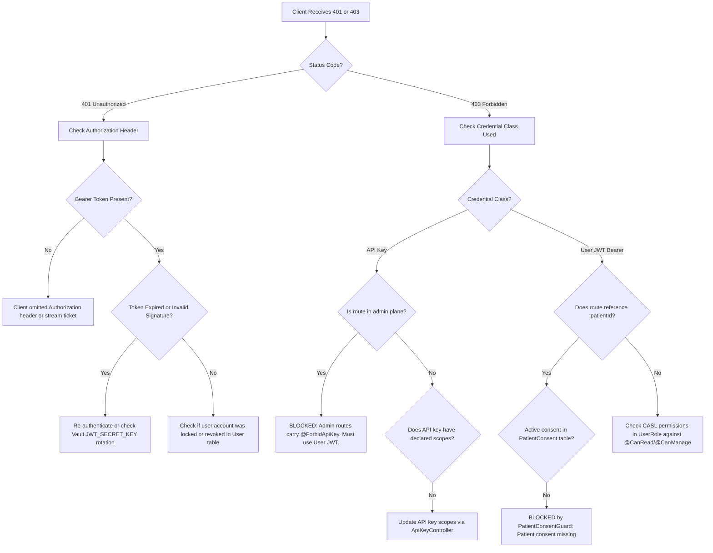
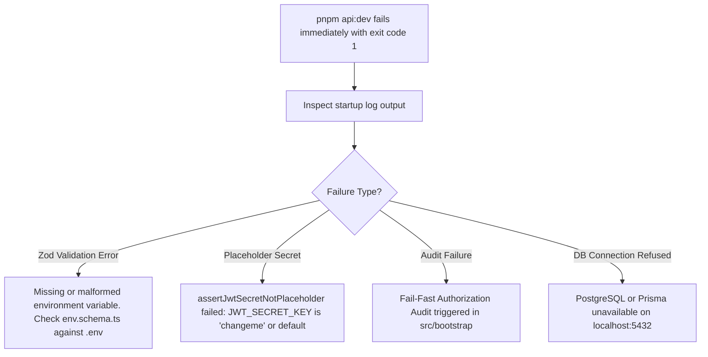

# Incident Troubleshooting Runbooks & Decision Trees

This document provides step-by-step diagnostic workflows for the most frequent issues encountered when developing against or running the HOPE API Gateway ([`apps/api`](file:///Users/apple/repos/VOX/project-hope/apps/api)).

---

## Runbook 1: Diagnosing 401 Unauthorized / 403 Forbidden



### Actionable Checkpoints:
1. **If using API Key:** Search [`route-manifest.json`](file:///Users/apple/repos/VOX/project-hope/apps/api/route-manifest.json) for your path. If `apiKeyForbidden: true`, this route cannot be reached by server-to-server API keys.
2. **If using JWT:** Decode your token (`jwt.io` or `jwt-cli`) and inspect:
   - `exp`: Is it in the past?
   - `tenantId`: Does it match the target resource's hospital/tenant?
   - `roles`: Does your role have permissions on the CASL subject?
3. **If 403 on Consultation Route:** Check if `:patientId` is present. If so, `PatientConsentGuard` ran and rejected the caller because the patient revoked or never granted consent.

---

## Runbook 2: Diagnosing 404 Not Found & Cross-Tenant Leaks

```text
Step 1: Check the URL prefix
  └── All business routes MUST be prefixed with `/api/v1/`
        ❌ Bad:  GET /consultations/123
        ✅ Good: GET /api/v1/consultations/123

Step 2: Check for 404-over-403 (Cross-Tenant Defense)
  └── Did the database record exist, but with a different tenantId?
        Run query: SELECT id, "tenantId" FROM "Consultation" WHERE id = 'c-123';
        • If tenantId matches caller JWT: Entity genuinely missing or soft-deleted.
        • If tenantId differs from caller JWT: Intentionally returned 404 to protect privacy.

Step 3: Check Subcollection Parent Binding
  └── Routes like `/api/v1/departments/:depId/rooms/:roomId`
        Verify that `roomId` actually belongs to `depId`. The gateway returns 404 if a room
        belongs to another department, even within the same hospital tenant.
```

---

## Runbook 3: Diagnosing 412 Concurrency Conflicts & 428 Preconditions

```text
Problem: PATCH /api/v1/consultations/:id returns 428 Precondition Required
  └── Cause: The route is marked with `@RequiresIfMatch()`.
  └── Solution:
        1. Perform a `GET /api/v1/consultations/:id` first.
        2. Read the `ETag` header from the response (e.g. `ETag: "14"`).
        3. Include `If-Match: "14"` in the headers of your PATCH request.

Problem: PATCH /api/v1/consultations/:id returns 412 Precondition Failed
  └── Cause: Race condition / concurrency conflict. Another user updated the record
      in the database and incremented `_version` from 14 to 15.
  └── Solution:
        1. Fetch the latest entity via GET.
        2. Merge your changes with the current state.
        3. Re-issue PATCH using the new `If-Match: "15"`.
```

---

## Runbook 4: Gateway Fails to Boot / Startup Crash



### Fixing Common Boot Audit Failures:
1. **`auditAdminRoutePermissions` failed:**
   - A newly created controller method forgot authorization. Add `@CanRead('Resource')`, `@CanManage('Resource')`, or `@Public()` above the handler.
2. **`auditApiKeyRequiredScopes` failed:**
   - A non-public route is accessible to API keys but did not declare required scopes. Add `@RequiredScopes('scope:name')` or add `@ForbidApiKey()` to the controller class.
3. **`auditConsentRouteCoverage` failed:**
   - A route contains `:patientId` in its path parameter without declaring patient consent rules. Add `@RequiresConsent()` or `@ConsentExempt('reason')`.

---

## Runbook 5: WebSocket (`/ws/stt/stream`) Disconnecting

```text
Symptom: Client connects to ws://localhost:8868/ws/stt/stream?ticket=XYZ and drops immediately.

Check 1: Was the Stream Ticket Expired?
  • Stream tickets have a strict 30-second TTL in Redis.
  • Stream tickets are single-use (atomically deleted on first read).
  • Fix: Request a fresh ticket immediately before opening the WebSocket socket.

Check 2: Origin Tenant Binding (CORS for WebSockets)
  • OriginTenantBindingGuard checks if the browser's `Origin` header is registered in the
    `TenantAllowedOrigin` table for the caller's tenant.
  • Fix: Verify the client app's domain (e.g. `http://localhost:3000`) is registered via
    `TenantAllowedOriginController`.

Check 3: Downstream Python STT Service Health
  • Is the Python STT service running on port 8861?
  • Run: curl http://localhost:8861/health
  • If STT engine crashed (e.g. CUDA OOM), the gateway closes the socket with code 1011.
```

---

## Runbook 6: SOAP Note Generation Stuck in `pending`

```text
Symptom: POST /api/v1/consultations/:id/summary returns { status: "pending" }
         but consultation state never transitions to "GENERATED".

Check 1: Temporal Workflow Execution
  • Open Temporal Web UI: http://localhost:8233
  • Search for WorkflowId: `consultation-harness-${consultationId}`
  • Status options:
      - Running: Check which step is active (Guides, Generate, Sensors, or Gate).
      - TimedOut / Failed: Inspect activity failure stack trace.

Check 2: Python Text Microservice (Port 8862)
  • Is the LLM service answering requests?
  • Run: curl http://localhost:8862/health
  • Check server logs for LLM provider rate limits (e.g. Azure OpenAI 429 Too Many Requests).

Check 3: Harness Internal Callback Ingress
  • When Temporal finishes generation, it calls back into:
    `POST /api/v1/internal/harness/callback`
  • Verify that `X-Service-Token` is correctly configured between Temporal workers and gateway.
```
