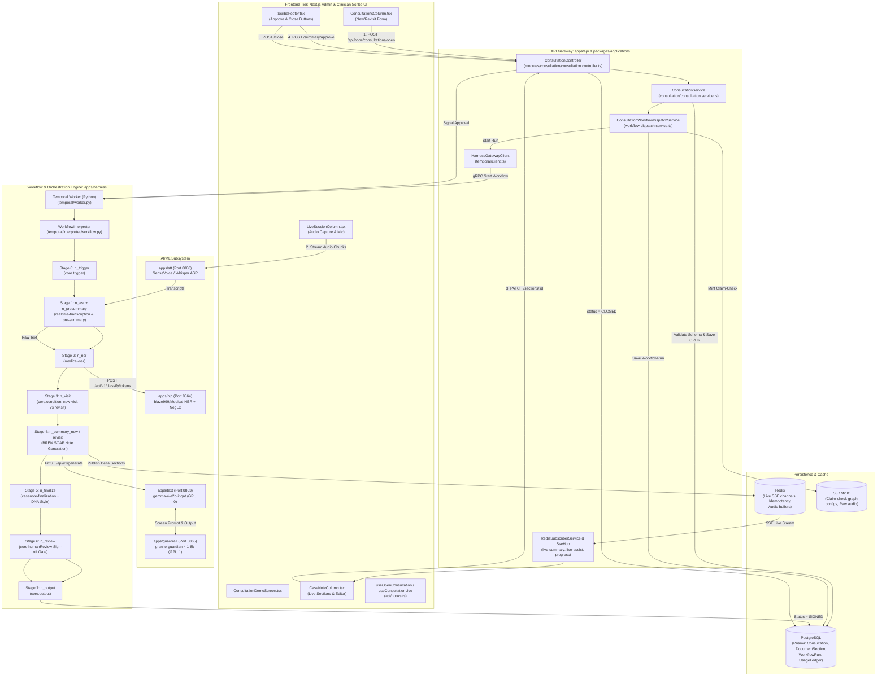
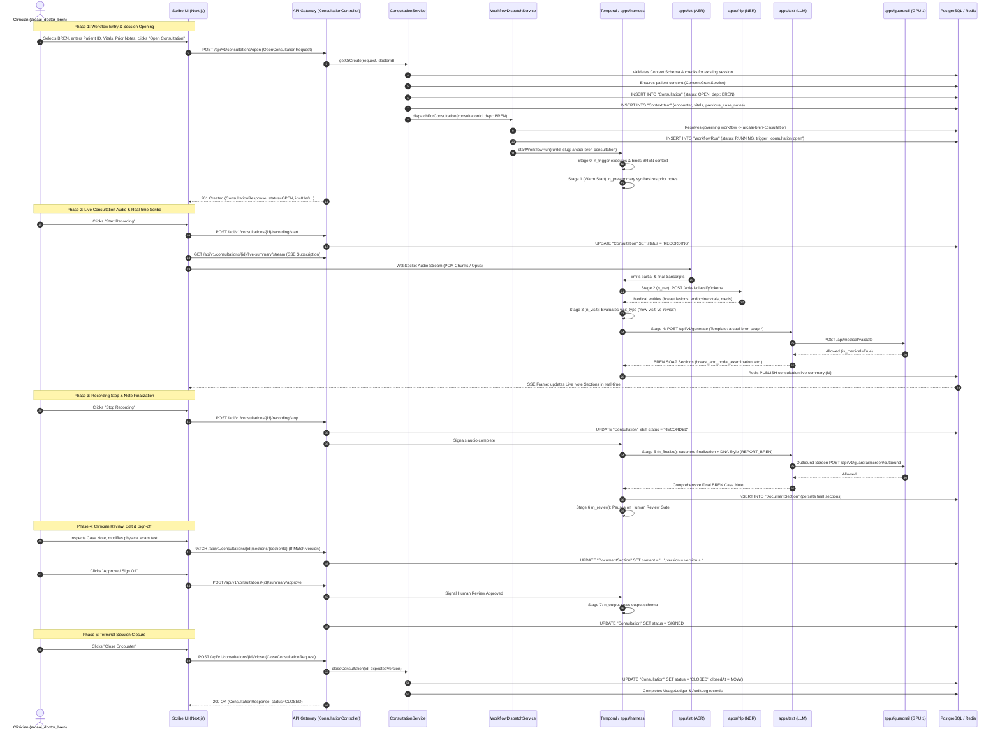
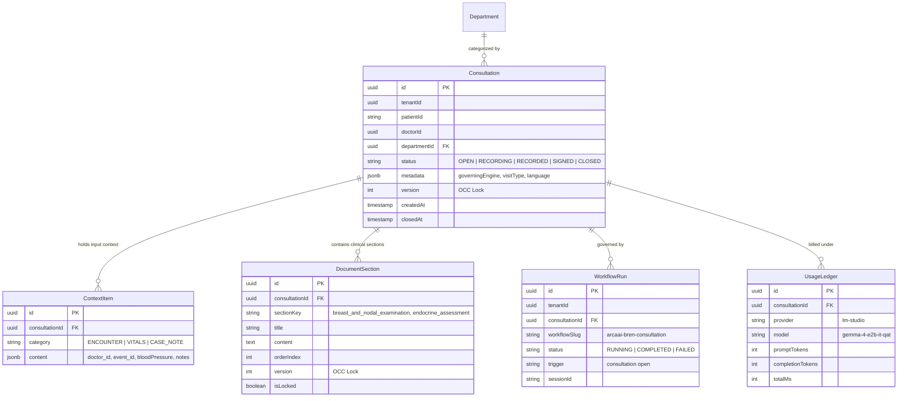

# End-to-End BREN (Breast & Endocrine Surgery) Workflow: Complete Codebase & Execution Flow Analysis

---

## 1. Executive Summary & Identity Mapping

In the HOPE platform, **BREN** designates the **Breast & Endocrine Surgery** clinical specialty department. The workflow is an automated, multimodal clinical documentation and orchestration pipeline governed by the following entities:

| Attribute | Value / Identifier | Source in Repository |
| :--- | :--- | :--- |
| **Tenant** | ArcaAI (`50000000-0000-0000-0000-000000000001`) | `packages/database/.../seed/00-constants.ts` |
| **Department Code** | `BREN` / Breast & Endocrine | `packages/database/.../seed/04-department.ts:353` |
| **Department ID** | `70000000-0000-0000-0001-000000000015` | `SEED_DEPARTMENT_IDS.BREN_ARCAAI` |
| **Assigned Doctor User** | `arcaai_doctor_bren` (`70000000-0000-0000-0000-000000000047`) | `packages/database/.../seed/91-user.ts:655` |
| **Governing Workflow Slug** | `arcaai-bren-consultation` | `packages/database/.../seed/29-arcaai-agents-and-workflows.generated.ts:4576` |
| **Workflow Definition ID** | `99000000-0000-0000-0001-000000000007` | `packages/database/.../seed/29-arcaai-agents-and-workflows.generated.ts:4588` |
| **Context Schema Contract** | `arcaai_consultation_scribe` v3 (`79000000-0000-0000-0001-000000000021`) | `packages/database/.../seed/07g-arcaai-two-schemas.ts` |
| **Clinical Templates** | `arcaai-bren-soap-new-visit` & `arcaai-bren-soap-revisit` | `packages/database/.../seed/07b-arcaai-clinical-templates.ts` |
| **Doctor DNA Writing Style** | `REPORT_BREN` (`73000000-0000-0000-0000-000000000007`) | `packages/database/.../seed/08-dna-writing-style.ts:116` |

---

## 2. High-Level Architecture Diagram

---

## 3. End-to-End Chronological Execution Sequence

---

## 4. Chronological Step-by-Step Codebase Trace

### Phase 1: Workflow Entry & Session Opening

#### Step 1: Frontend User Initiation
* **File:** [`apps/admin-console/src/features/playground-consultation/components/scribe/consultations-column.tsx`](file:///Users/apple/Desktop/project-hope/apps/admin-console/src/features/playground-consultation/components/scribe/consultations-column.tsx#L180-L240)
* **Component / Method:** `ConsultationsColumn.tsx` -> `handleOpenConsultation()`
* **Called By:** Doctor interaction on `ConsultationDemoScreen.tsx`.
* **Execution:**
  1. The doctor selects department `BREN` ("Breast & Endocrine"), selects `visitType` (`new-visit` or `revisit`), enters patient demographic ID, past medical history notes, vitals, and clicks **"Open Consultation"**.
  2. Invokes hook `useOpenConsultation()` in [`apps/admin-console/src/features/playground-consultation/api/hooks.ts`](file:///Users/apple/Desktop/project-hope/apps/admin-console/src/features/playground-consultation/api/hooks.ts#L65).
  3. `hooks.ts` dispatches `openConsultation(input)` in [`apps/admin-console/src/features/playground-consultation/api/client.ts`](file:///Users/apple/Desktop/project-hope/apps/admin-console/src/features/playground-consultation/api/client.ts#L95).
  4. Sends HTTP `POST /api/hope/consultations/open` to Next.js API route proxy, which forwards to backend `POST /api/v1/consultations/open`.

#### Step 2: Gateway Receipt & Schema Validation
* **File:** [`apps/api/src/modules/consultation/consultation.controller.ts`](file:///Users/apple/Desktop/project-hope/apps/api/src/modules/consultation/consultation.controller.ts#L546-L586)
* **Method:** `ConsultationController.open(@Body() request: OpenConsultationRequest)`
* **Next Call:** `this.consultationService.getOrCreate(request, doctorId)` in [`packages/applications/src/services/consultation/consultation/consultation.service.ts`](file:///Users/apple/Desktop/project-hope/packages/applications/src/services/consultation/consultation/consultation.service.ts#L1035).
* **Execution & Guards:**
  1. `resolveOpenContext()` validates context payload against pinned schema `arcaai_consultation_scribe` v3 (`contextSchemaId: 79000000-0000-0000-0001-000000000021`).
  2. Resolves department ID for code `BREN`: `SEED_DEPARTMENT_IDS.BREN_ARCAAI` (`70000000-0000-0000-0001-000000000015`).
  3. Validates clinician privileges: `assertNamedClinicianMayOwnConsultation()`.
  4. Guarantees patient consent: `consentGrantService.ensureConsultationConsent()`.
  5. Meters monthly consultation usage: `entitlements.assertMeterQuota()`.
  6. Inserts `Consultation` database row into PostgreSQL with `status: OPEN`.
  7. Persists input context into `ContextItem` table via `persistOpenContext()` (`category: ENCOUNTER, VITALS, CASE_NOTE`).

#### Step 3: Governing Workflow Resolution & Temporal Dispatch
* **File:** [`packages/applications/src/services/consultation/workflow-dispatch/consultation-workflow-dispatch.service.ts`](file:///Users/apple/Desktop/project-hope/packages/applications/src/services/consultation/workflow-dispatch/consultation-workflow-dispatch.service.ts#L163-L320)
* **Method:** `ConsultationWorkflowDispatchService.dispatchForConsultation(input)`
* **Called By:** `ConsultationService.getOrCreate()` at line 1245.
* **Execution:**
  1. Calls `assignments.resolve(tenantId, 'core', departmentId='...BREN...')`: resolves to **`arcaai-bren-consultation`** (`definitionId: 99000000-0000-0000-0001-000000000007`).
  2. Resolves STT pipeline ID for audio processing.
  3. Uploads compiled DAG configuration to S3/MinIO claim-check storage (`mintCompiledConfigClaimCheckRef`).
  4. Creates database row in PostgreSQL: `WorkflowRun` (`runId`, `trigger: 'consultation open'`, `status: RUNNING`).
  5. Dispatches Temporal workflow run via gRPC: `harnessGateway.startWorkflowRun(...)`.
  6. Attaches terminal-status watcher: `runCompletion.watch(tenantId, runId, consultationId)`.
  7. Stamps governance metadata on consultation row: `metadata.governingEngine = { engine: 'tenant-workflow', workflowDefinitionSlug: 'arcaai-bren-consultation', workflowRunId: '...' }`.

---

### Phase 2: Live Audio Streaming & Real-Time Scribing

#### Step 4: Stage 0 (Trigger) & Stage 1 (Warm Start Pre-Summary)
* **File:** [`packages/database/src/prisma/db_main/seed/29-arcaai-agents-and-workflows.generated.ts`](file:///Users/apple/Desktop/project-hope/packages/database/src/prisma/db_main/seed/29-arcaai-agents-and-workflows.generated.ts#L4600-L4980)
* **Worker Execution:** Temporal Worker (`apps/harness/src/harness/temporal/worker.py`) executes:
  * **Stage 0 (`n_trigger` / `core.trigger`)**: Unpacks `run_payload` (encounter metadata, vitals, previous visit notes) and validates against schema `additionalProperties: false`. Binds variables into `trigger.context.*`.
  * **Stage 1A (`n_asr` / `core.agent`: `realtime-transcription`)**: Initializes speech ingestion listener in the `realtime` lane (`cadence: perTurn`).
  * **Stage 1B (`n_presummary` / `core.agent`: `case-notes-pre-summary`)**: Executes `cadence: onStart`. Synthesizes prior visit notes into `pre_summary_text` before recording begins.

#### Step 5: Recording Start & Audio WebSocket Ingestion
* **File:** [`apps/api/src/modules/consultation/consultation.controller.ts`](file:///Users/apple/Desktop/project-hope/apps/api/src/modules/consultation/consultation.controller.ts#L945-L985)
* **Method:** `ConsultationController.startRecording(@Param('id') id)`
* **Action:** Clinician presses **"Start Recording"** in `LiveSessionColumn.tsx`.
* **Execution:**
  1. API updates PostgreSQL: `UPDATE "Consultation" SET status = 'RECORDING'`.
  2. Clinician UI opens Server-Sent Events (SSE) feed: `GET /api/v1/consultations/{id}/live-summary/stream`.
  3. Client mic streams PCM/Opus audio chunks via WebSocket to `apps/stt` (port 8866).
  4. `apps/stt` performs streaming transcription (Malayalam/Manglish/English), yielding incremental transcript chunks to Temporal `n_asr`.

#### Step 6: Stage 2 Clinical NER Entity Extraction
* **File:** Node `n_ner` (`core.agent`: `medical-ner`) in [`apps/harness/src/harness/temporal/interpreter/nodes/consultation_nlp.py`](file:///Users/apple/Desktop/project-hope/apps/harness/src/harness/temporal/interpreter/nodes/consultation_nlp.py)
* **Called By:** Interpreter loop whenever new transcript segments arrive.
* **Next Call:** HTTP `POST /api/v1/classify/tokens` on `apps/nlp` (port 8864).
* **AI Model:** **`blaze999/Medical-NER`** (fine-tuned `microsoft/deberta-v3-base`).
* **Processing:**
  1. Extracts clinical spans: Breast lumps, skin tethering, nipple discharge, axillary lymphadenopathy, thyroid nodules, TSH, Thyroxine dosage.
  2. Runs **NegEx Assertion Engine** (`assertion.py`) to classify affirmed vs negated findings (e.g., *"no nipple retraction"*, *"no palpable axillary nodes"*).
  3. Runs **Vitals Extractor** (`vitals_extractor.py`) for physiological values.
  4. Injects structured entity map into `trigger.context.ner_entities`.

#### Step 7: Stage 3 & Stage 4 Visit Branching & Specialty Note Generation
* **File:** Node `n_visit` (`core.condition`) & Node `n_summary_new` / `n_summary_revisit`
* **Branching Logic:**
  * Condition: `trigger.context.visit_type == 'new-visit'` vs `revisit`.
  * If `new-visit`: Activates `n_summary_new` (`arcaai-bren-summary-new-visit`, Document Template `arcaai-bren-soap-new-visit`).
  * If `revisit`: Activates `n_summary_revisit` (`arcaai-bren-summary-revisit`, Document Template `arcaai-bren-soap-revisit`).
* **LLM Invocation:**
  1. Calls `apps/text` at `POST /api/v1/generate` (model: `gemma-4-e2b-it-qat` on GPU 0).
  2. Pre-execution safety check evaluated by `apps/guardrail` (port 8865) against `granite-guardian-4.1-8b` on GPU 1.
  3. Generates structured BREN sections:
     - `chief_complaint` & `history_of_present_illness`
     - `breast_and_nodal_examination` (quadrant inspection, palpation, lymph node basins)
     - `endocrine_assessment` (thyroid gland, symptoms of hypo/hyperthyroidism)
     - `investigation_review` (Mammogram, USG, FNAC/Core Biopsy, TSH, FT4)
     - `diagnosis_and_staging`
     - `treatment_plan`
* **Real-time Live Relay:**
  1. Chunks are published to Redis channel `consultation:live-summary:{id}`.
  2. Subscribed client receives updates over SSE (`GET /api/v1/consultations/{id}/live-summary/stream`).
  3. `CaseNoteColumn.tsx` updates live text on the clinician's screen.

---

### Phase 3: Recording Stop & Note Finalization

#### Step 8: Recording Stop & Stage 5 Finalization
* **File:** [`apps/api/src/modules/consultation/consultation.controller.ts`](file:///Users/apple/Desktop/project-hope/apps/api/src/modules/consultation/consultation.controller.ts#L988-L1015)
* **Method:** `ConsultationController.stopRecording(@Param('id') id)`
* **Action:** Clinician clicks **"Stop Recording"**.
* **Execution:**
  1. API updates PostgreSQL: `UPDATE "Consultation" SET status = 'RECORDED'`.
  2. Temporal triggers Node `n_finalize` (`casenote-finalization` agent, `cadence: onEnd`).
  3. Injects doctor's personal DNA writing style: `SEED_DNA_REPORT_IDS.REPORT_BREN` (`73000000-0000-0000-0000-000000000007`).
  4. Post-execution output guardrail check: `apps/text` calls `apps/guardrail` at `POST /api/v1/guardrail/screen/outbound` (verifies safety, absence of hallucinations, and no PII leakage).
  5. Writes durable sections into PostgreSQL `DocumentSection` table.

---

### Phase 4: Clinician Review, Edit & Sign-off

#### Step 9: Stage 6 Clinician Review & Manual Editing
* **File:** Node `n_review` (`core.humanReview`) in [`apps/harness/src/harness/temporal/interpreter/review_workflow.py`](file:///Users/apple/Desktop/project-hope/apps/harness/src/harness/temporal/interpreter/review_workflow.py)
* **Execution:**
  1. Pauses Temporal execution tree (`activity: interpreter.core_human_review`).
  2. Emits status `AWAITING_REVIEW` to frontend.
  3. **Clinician Section Editing:** If the doctor modifies text, frontend fires `PATCH /api/v1/consultations/{id}/sections/{sectionId}` with `If-Match: "{expectedVersion}"`. Optimistic Concurrency Control (OCC) verifies version match; updates `DocumentSection.content`.
  4. **Clinician Approval (Sign-off):**
     - Doctor clicks **"Approve Note"** in `ScribeFooter.tsx`.
     - API Call: `POST /api/v1/consultations/{id}/summary/approve`.
     - API signals Temporal review activity: `Approved`.
     - Stage 7 (`n_output`) runs, seals the output schema, and updates database: `Consultation.status = SIGNED`.

---

### Phase 5: Terminal Session Closure

#### Step 10: Terminal Session Closure
* **File:** [`apps/api/src/modules/consultation/consultation.controller.ts`](file:///Users/apple/Desktop/project-hope/apps/api/src/modules/consultation/consultation.controller.ts#L846-L895)
* **Method:** `ConsultationController.close(@Param('id') id, @Body() body: CloseConsultationRequest)`
* **Action:** Doctor clicks **"Close Encounter"** or workflow completes.
* **Next Call:** `consultationService.closeConsultation(id, expectedVersion, { caller })` in [`consultation.service.ts`](file:///Users/apple/Desktop/project-hope/packages/applications/src/services/consultation/consultation/consultation.service.ts#L1730).
* **Database Updates:**
  1. `UPDATE "Consultation" SET status = 'CLOSED', closedAt = NOW(), version = version + 1`.
  2. Finalizes `UsageLedger` billing entries.
  3. Emits `SysEventType.ResourceUpdated` event.
  4. Returns `ConsultationResponse` with `status: CLOSED`.

---

## 5. Patient Session Lifecycle & State Transitions

```mermaid
stateDiagram-v2
    [*] --> OPEN: POST /api/v1/consultations/open
    
    OPEN --> RECORDING: POST /recording/start (Doctor starts audio)
    OPEN --> CLOSED_INCOMPLETE: Doctor exits / abandons consultation
    
    RECORDING --> RECORDING: Audio streaming & Live ASR/NER/SOAP Generation
    RECORDING --> RECORDED: POST /recording/stop (Audio finished)
    RECORDING --> FAILED: Engine timeout / Pipeline crash
    
    RECORDED --> FINALIZING: Temporal triggers Stage 5 (n_finalize)
    FINALIZING --> AWAITING_REVIEW: Note generated; Stage 6 (n_review) pauses
    FINALIZING --> FAILED: LLM or Guardrail fatal refusal
    
    AWAITING_REVIEW --> AWAITING_REVIEW: PATCH /sections/:id (Clinician edits)
    AWAITING_REVIEW --> SIGNED: POST /summary/approve (Doctor signs off)
    AWAITING_REVIEW --> REJECTED: Doctor rejects note finalization
    
    SIGNED --> CLOSED: POST /close (Encounter sealed)
    FAILED --> CLOSED_INCOMPLETE: Doctor closes failed consultation
    REJECTED --> CLOSED_INCOMPLETE: Doctor closes without approval
    
    CLOSED --> [*]
    CLOSED_INCOMPLETE --> [*]
```

### State Machine Reference

| State | Triggering Action / API | Database Changes | Reversible? | Next Valid States |
| :--- | :--- | :--- | :---: | :--- |
| **`OPEN`** | `POST /api/v1/consultations/open` | `status = 'OPEN'`, creates `ContextItem` rows. | Yes | `RECORDING`, `CLOSED_INCOMPLETE` |
| **`RECORDING`** | `POST /api/v1/consultations/{id}/recording/start` | `status = 'RECORDING'`. STT & LiveDoc active. | Yes | `RECORDED`, `FAILED` |
| **`RECORDED`** | `POST /api/v1/consultations/{id}/recording/stop` | `status = 'RECORDED'`. Closes live audio channel. | No | `FINALIZING` |
| **`FINALIZING`** | Internal Temporal trigger (`n_finalize`) | Synthesizing comprehensive case note. | No | `AWAITING_REVIEW`, `FAILED` |
| **`AWAITING_REVIEW`**| Temporal Stage 6 (`n_review`) paused | Note sections persisted into `DocumentSection`. | Yes (edits allowed) | `SIGNED`, `REJECTED` |
| **`SIGNED`** | `POST /api/v1/consultations/{id}/summary/approve` | `status = 'SIGNED'`, sets signed timestamp and clinician ID. | No | `CLOSED` |
| **`CLOSED`** | `POST /api/v1/consultations/{id}/close` | `status = 'CLOSED'`, `closedAt = NOW()`. Locked. | **Terminal** | None |
| **`CLOSED_INCOMPLETE`**| `POST /close` prior to signature | `status = 'CLOSED_INCOMPLETE'`. Audit recorded. | **Terminal** | None |

---

## 6. API Inventory

| HTTP Method | Route | Responsible File & Method | Input Parameters | Output Response |
| :--- | :--- | :--- | :--- | :--- |
| **`POST`** | `/api/v1/consultations/open` | `ConsultationController.open` ([L546](file:///Users/apple/Desktop/project-hope/apps/api/src/modules/consultation/consultation.controller.ts#L546)) | `OpenConsultationRequest` (`patientId`, `departmentId`, `language`, `context`) | `ConsultationResponse` (status `OPEN`, `id`, `metadata.governingEngine`) |
| **`POST`** | `/api/v1/consultations/{id}/recording/start` | `ConsultationController.startRecording` ([L945](file:///Users/apple/Desktop/project-hope/apps/api/src/modules/consultation/consultation.controller.ts#L945)) | `id` (path) | `RecordingStateResponse` (`status: RECORDING`) |
| **`GET`** | `/api/v1/consultations/{id}/live-summary/stream` | `ConsultationController.streamLiveSummary` ([L1020](file:///Users/apple/Desktop/project-hope/apps/api/src/modules/consultation/consultation.controller.ts#L1020)) | `id` (path), SSE auth token/ticket | SSE stream of `LiveSummaryEventDto` chunks |
| **`POST`** | `/api/v1/consultations/{id}/recording/stop` | `ConsultationController.stopRecording` ([L985](file:///Users/apple/Desktop/project-hope/apps/api/src/modules/consultation/consultation.controller.ts#L985)) | `id` (path) | `RecordingStateResponse` (`status: RECORDED`) |
| **`PATCH`** | `/api/v1/consultations/{id}/sections/{sectionId}` | `ConsultationController.updateDocumentSection` ([L1437](file:///Users/apple/Desktop/project-hope/apps/api/src/modules/consultation/consultation.controller.ts#L1437)) | `id`, `sectionId`, `If-Match`, `content` | `DocumentSectionResponse` (updated version & text) |
| **`POST`** | `/api/v1/consultations/{id}/summary/approve` | `ConsultationController.approveSummary` ([L2025](file:///Users/apple/Desktop/project-hope/apps/api/src/modules/consultation/consultation.controller.ts#L2025)) | `id`, `SummaryApprovalRequest` | `SummaryResponse` (`status: SIGNED`) |
| **`POST`** | `/api/v1/consultations/{id}/close` | `ConsultationController.close` ([L846](file:///Users/apple/Desktop/project-hope/apps/api/src/modules/consultation/consultation.controller.ts#L846)) | `id`, `CloseConsultationRequest`, `If-Match` | `ConsultationResponse` (`status: CLOSED`) |
| **`GET`** | `/api/v1/consultations/{id}/workflow` | `ConsultationController.getGoverningWorkflow` ([L676](file:///Users/apple/Desktop/project-hope/apps/api/src/modules/consultation/consultation.controller.ts#L676)) | `id` (path) | `ConsultationWorkflowResponse` (`governed: true`, `slug: arcaai-bren-consultation`) |

---

## 7. Database Mapping (PostgreSQL Schema)

---

## 8. Error Handling, Edge Cases & Recovery Mechanisms

1. **Context Schema Mismatch (`HTTP 400 CONTEXT_SCHEMA_VIOLATION`):**
   * Pre-execution validation verifies `request.context` against schema `arcaai_consultation_scribe` v3 before database writes. Prevents downstream pipeline failures.
2. **Concurrent Edits & Replay Collisions (`HTTP 409 OCC Conflict`):**
   * Handled by `@RequiresIfMatch()` and `@ExpectedVersion()` on all consultation and section updates. If a doctor modifies an outdated section, the request is rejected with HTTP 409, prompting the client to reload the latest state.
3. **Temporal Worker Blip / Harness Outage:**
   * Handled fail-safe in `workflow-dispatch.service.ts`: If Temporal or the harness gateway is unreachable during consultation opening, the call logs a warning and returns `dispatched: false`. The consultation remains safely `OPEN` in Substrate A, falling back to the standard synchronous note generation pipeline rather than failing the clinician's consultation.
4. **LLM Provider Crash / Timeout:**
   * If `apps/text` fails or times out during `n_summary_*`, the node's `onError: "degrade"` configuration prevents the entire consultation from crashing. The live session continues, and the finalizer synthesizes the note from available ASR transcripts and prior context items during Step 8.
5. **Medical Guardrail Refusal (`HTTP 422 Content Blocked`):**
   * If `apps/guardrail` flags prompt content as non-clinical (`CONTENT_BLOCKED_NOT_MEDICAL`) or unsafe, note generation terminates fail-closed, and an alert is dispatched to `consultation:live-assist:{id}` for doctor review.
6. **Session Abandonment / Browser Disconnect:**
   * If a doctor closes the browser during a live session, the heartbeat ping timeout in `LiveDocumentationService` (15 seconds) automatically detects disconnection. The consultation remains in `RECORDED` or `AWAITING_REVIEW` state, allowing the clinician to log back in, resume, review, and close the encounter at any time.
