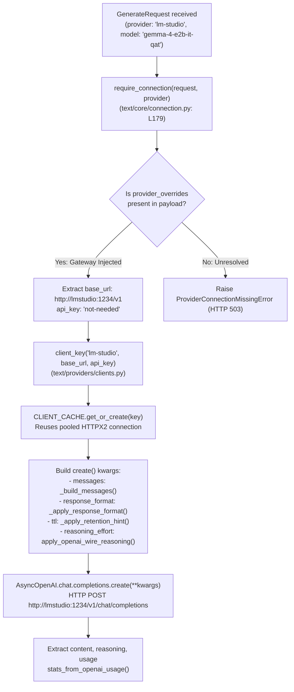
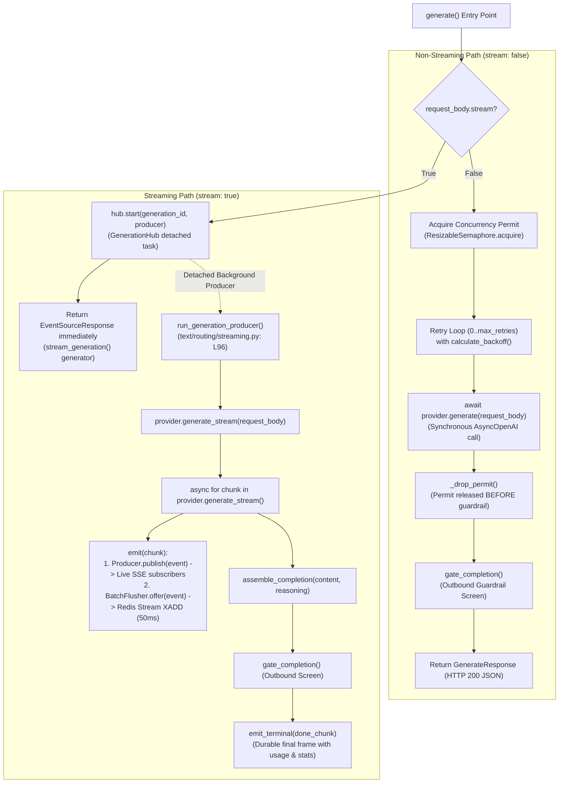
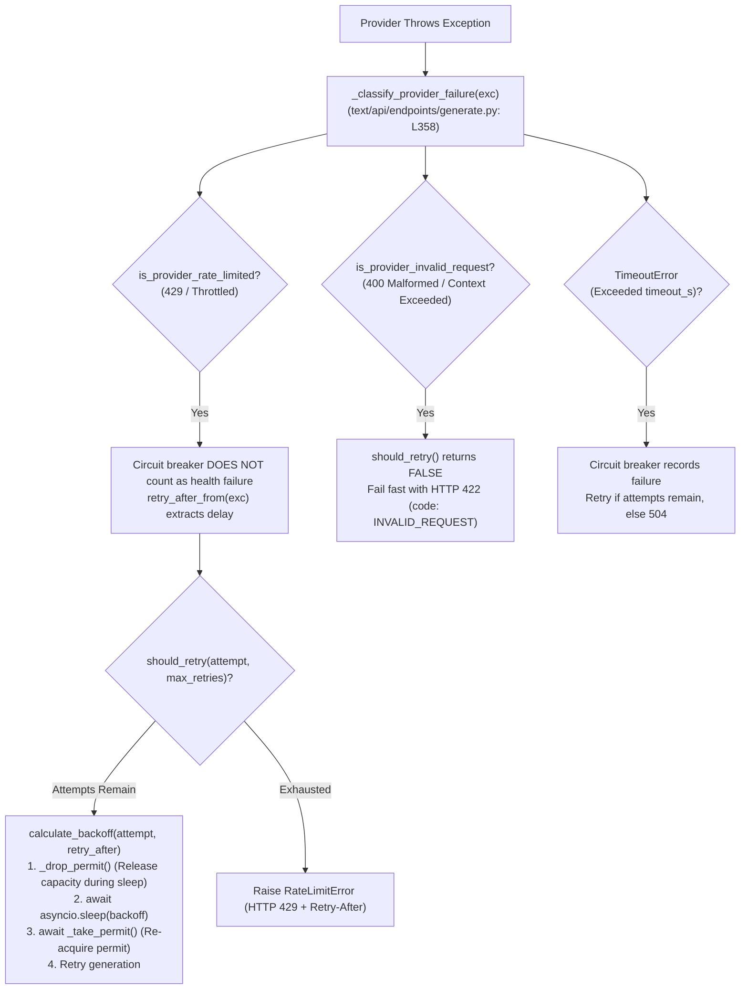
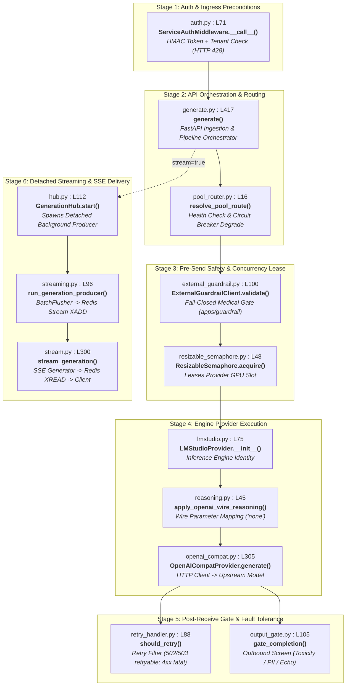

# LLM Service – Internal Execution & Component-Level Analysis (BREN Workflow)

---

## 5.1 LLM Service Entry Point

### 1. Inbound Invocations from the BREN Workflow
The BREN (Breast & Endocrine Surgery) clinical workflow invokes the LLM service (`apps/text`) in two distinct execution modes:

1. **Synchronous Node Execution (Temporal Activities):**
   * **Calling Component:** `interpreter_text_generate` in [`apps/harness/src/harness/temporal/interpreter/nodes/text_generate.py:97`](file:///Users/apple/Desktop/project-hope/apps/harness/src/harness/temporal/interpreter/nodes/text_generate.py#L97).
   * **Calling Method:** `TextClient.generate()` in [`apps/harness/src/harness/services/text_client.py:200`](file:///Users/apple/Desktop/project-hope/apps/harness/src/harness/services/text_client.py#L200).
   * **Target Endpoint:** `POST /api/v1/generate` (with payload parameter `stream: false`).
2. **Real-time Live Scribing (Live Stream Relay):**
   * **Calling Component:** `LiveDocumentationService` in [`packages/applications/src/services/consultation/live-documentation/live-documentation.service.ts:5880`](file:///Users/apple/Desktop/project-hope/packages/applications/src/services/consultation/live-documentation/live-documentation.service.ts#L5880).
   * **Target Endpoint:** `POST /api/v1/generate` (with payload parameter `stream: true`).

### 2. Route Handler & ASGI Middleware Pipeline
When the HTTP request enters `apps/text` (FastAPI / Uvicorn, port 8863), it passes through an outermost-to-innermost ASGI middleware stack:

```
[Raw HTTP Socket]
      │
      ▼
 1. AccessLogMiddleware (hope_obs)
      │  Captures request start timestamp, logs HTTP method, path, remote IP.
      ▼
 2. RequestContextMiddleware (hope_obs)
      │  Extracts `X-Request-ID` (or generates a UUID) and `X-Tenant-Id`.
      │  Binds them to `structlog.contextvars` and OpenTelemetry span context.
      ▼
 3. ServiceAuthMiddleware (text.api.middleware.auth: L71)
      │  Exempt Path Check: Bypasses checks only for `/metrics`, `/docs`, `/health/*`.
      │  Precondition 1 (Auth): Reads `X-Service-Token`. Constant-time HMAC comparison 
      │    `hmac.compare_digest()` against `settings.peer_service_token()`. (401 on mismatch).
      │  Precondition 2 (Tenancy): Reads `X-Tenant-Id`. Validates presence or `tenantless:<reason>`. 
      │    Raises `HTTP 428 Precondition Required` if absent.
      ▼
 4. FastAPI Router & Pydantic Validation
      │  Route: `generate()` in `text.api.endpoints.generate: L417`.
      │  Validates body against Pydantic model `GenerateRequest` (text.models.requests: L88).
```

### 3. Request Validation Schema (`GenerateRequest`)
Defined in [`apps/text/src/text/models/requests.py:88`](file:///Users/apple/Desktop/project-hope/apps/text/src/text/models/requests.py#L88):
* `prompt` (`str`): Mandatory input prompt containing BREN clinical instructions and variables.
* `system_prompt` (`str | None`): System instructions (e.g. clinical boundaries, language).
* `provider` (`str`): Target provider name (e.g. `"lm-studio"`).
* `model` (`str`): Model name (e.g. `"gemma-4-e2b-it-qat"`). If blank, fails with `HTTP 422`.
* `temperature`, `max_tokens`, `top_p` (`float | int | None`): Generation hyperparameters.
* `stream` (`bool`): `False` for synchronous Temporal node, `True` for live streaming.
* `response_format` (`ResponseFormat | None`): Structured JSON schema directives.
* `guardrail_policy` (`dict | None`): Tenant-specific guardrail rules pushed with request.
* `provider_overrides` (`dict[str, ProviderOverride] | None`): Gateway-resolved credentials (`base_url`, `api_key`).

---

## 5.2 Complete Internal Function Call Chain

```
HTTP POST /api/v1/generate
 │
 ├──▶ ServiceAuthMiddleware.__call__() [text/api/middleware/auth.py: L71]
 │      ├── hmac.compare_digest(token, expected)
 │      └── assert_tenant_matches_header(x_tenant_id)
 │
 ├──▶ generate() [text/api/endpoints/generate.py: L417]
 │      │
 │      ├── 1. Shutdown Check: shutdown_manager.is_shutting_down [L441]
 │      │
 │      ├── 2. Pool Health Routing: resolve_pool_route() [text/services/pool_router.py: L16]
 │      │        └── pool_health_tracker.is_healthy(provider)
 │      │
 │      ├── 3. Idempotency Check (stream=false): [L473]
 │      │        └── redis_client.get(f"text:idem:{idempotency_key}")
 │      │
 │      ├── 4. Input Guardrail Gate: _apply_guardrail_gate() [L171]
 │      │        ├── assert_not_in_judge_scope() [text/services/judge_guard.py]
 │      │        └── ExternalGuardrailClient.validate() [text/services/external_guardrail.py: L100]
 │      │              ├── resolve_posture(platform, tenant_policy)
 │      │              └── HTTP POST http://guardrail:8865/api/medical/validate
 │      │
 │      ├── 5. Concurrency & Rate Limiting: [L510-L562]
 │      │        ├── RateLimitTracker.can_proceed(estimated_tokens)
 │      │        │     └── (if rate exceeded) ProviderQueue.enqueue(future)
 │      │        └── CircuitBreaker.allow_request()
 │      │
 │      ├── 6. Provider Resolution: ProviderRegistry.get("lm-studio") [L564]
 │      │        └── Returns LMStudioProvider instance
 │      │
 │      ├── 7. Task Registration: task_manager.create_task() [L571]
 │      │        └── redis.hset(f"text:task:{task_id}")
 │      │
 │      ├── 8. Concurrency Semaphore: ResizableSemaphore.acquire() [L665]
 │      │        └── asyncio.wait_for(semaphore.acquire(), timeout=30.0)
 │      │
 │      ├── 9. Provider Execution & Retry Loop: [L714-L786]
 │      │        ├── count_provider_bytes(provider) [text/providers/pool.py]
 │      │        │
 │      │        └── LMStudioProvider.generate(request_body) [text/providers/openai_compat.py: L305]
 │      │              ├── _client_for(request) [L170]
 │      │              │     ├── require_connection() [text/core/connection.py]
 │      │              │     └── CLIENT_CACHE.get_or_create(key) [text/providers/clients.py]
 │      │              ├── _build_messages(request) [L256]
 │      │              ├── _apply_response_format(kwargs) [L285]
 │      │              ├── _apply_retention_hint(kwargs) [LMStudioProvider overrides -> ttl]
 │      │              ├── apply_openai_wire_reasoning() [text/core/reasoning.py: L45]
 │      │              ├── AsyncOpenAI.chat.completions.create(**kwargs) [L333]
 │      │              │     └── (HTTP POST to LM Studio on GPU 0)
 │      │              └── stats_from_openai_usage() [text/models/stats.py]
 │      │
 │      ├── 10. Early Permit Release: _drop_permit() [L796]
 │      │         └── ResizableSemaphore.release() (released BEFORE post-receive gate)
 │      │
 │      ├── 11. Post-Receive Guardrail Gate: gate_completion() [text/services/output_gate.py: L105]
 │      │         ├── assemble_completion(content, reasoning)
 │      │         └── ExternalGuardrailClient.screen_output() [text/services/external_guardrail.py: L165]
 │      │               └── HTTP POST http://guardrail:8865/api/v1/guardrail/screen/outbound
 │      │
 │      ├── 12. Token & Usage Accounting: build_usage_detail() [text/models/usage.py: L88]
 │      │
 │      ├── 13. Task Update: task_manager.update_task(status=COMPLETED) [L863]
 │      │
 │      ├── 14. Metrics & Telemetry: [L876-L930]
 │      │         ├── GENERATION_TOTAL.inc(), GENERATION_LATENCY.observe()
 │      │         ├── set_generation_span_attributes(span)
 │      │         └── GenerationAuditLogger.log_generation() [text/services/generation_audit.py]
 │      │
 │      ├── 15. Idempotency Cache Write: [L964]
 │      │         └── redis.set(f"text:idem:{key}", response.model_dump_json(), ex=86400)
 │      │
 │      └── 16. Return GenerateResponse [L971]
```

---

## 5.3 Internal Components & Source Code Files

| Subsystem | Primary Code Files | Responsibility |
| :--- | :--- | :--- |
| **ASGI Middleware** | [`apps/text/src/text/api/middleware/auth.py`](file:///Users/apple/Desktop/project-hope/apps/text/src/text/api/middleware/auth.py) | Service token verification (`hmac.compare_digest`), tenant precondition enforcement (`428`). |
| **API Endpoints** | [`apps/text/src/text/api/endpoints/generate.py`](file:///Users/apple/Desktop/project-hope/apps/text/src/text/api/endpoints/generate.py)<br>[`apps/text/src/text/api/endpoints/stream.py`](file:///Users/apple/Desktop/project-hope/apps/text/src/text/api/endpoints/stream.py) | Route handlers for non-streaming (`generate`), streaming, SSE fan-out, and resume subscriptions. |
| **Provider Registry & Factory** | [`apps/text/src/text/providers/base.py`](file:///Users/apple/Desktop/project-hope/apps/text/src/text/providers/base.py)<br>[`apps/text/src/text/main.py:66-137`](file:///Users/apple/Desktop/project-hope/apps/text/src/text/main.py#L66-L137) | Lazy registration and instantiation of provider adapters (`lm-studio`, `vllm`, `openai`, `anthropic`). |
| **Engine Adapters** | [`apps/text/src/text/providers/lmstudio.py`](file:///Users/apple/Desktop/project-hope/apps/text/src/text/providers/lmstudio.py)<br>[`apps/text/src/text/providers/openai_compat.py`](file:///Users/apple/Desktop/project-hope/apps/text/src/text/providers/openai_compat.py) | Concrete OpenAI-wire adapters; manages connection pooling, reasoning parameters, and JIT retention hints (`ttl`). |
| **Streaming Engine** | [`apps/text/src/text/routing/hub.py`](file:///Users/apple/Desktop/project-hope/apps/text/src/text/routing/hub.py)<br>[`apps/text/src/text/routing/streaming.py`](file:///Users/apple/Desktop/project-hope/apps/text/src/text/routing/streaming.py) | `GenerationHub` detached background producer; `BatchFlusher` coalescing chunks into Redis Streams (`XADD`). |
| **Guardrail Client & Gates** | [`apps/text/src/text/services/external_guardrail.py`](file:///Users/apple/Desktop/project-hope/apps/text/src/text/services/external_guardrail.py)<br>[`apps/text/src/text/services/output_gate.py`](file:///Users/apple/Desktop/project-hope/apps/text/src/text/services/output_gate.py) | Calls `apps/guardrail` for pre-receive input validation (`/api/medical/validate`) and post-receive output screening. |
| **Concurrency & Rate Limits** | [`apps/text/src/text/services/resizable_semaphore.py`](file:///Users/apple/Desktop/project-hope/apps/text/src/text/services/resizable_semaphore.py)<br>[`apps/text/src/text/services/rate_limiter.py`](file:///Users/apple/Desktop/project-hope/apps/text/src/text/services/rate_limiter.py)<br>[`apps/text/src/text/services/circuit_breaker.py`](file:///Users/apple/Desktop/project-hope/apps/text/src/text/services/circuit_breaker.py) | Concurrency permit leasing, token rate limits (RPM/TPM), circuit breaker failure tracking. |
| **Task & State Store** | [`apps/text/src/text/services/task_manager.py`](file:///Users/apple/Desktop/project-hope/apps/text/src/text/services/task_manager.py) | Redis task state persistence (`text:task:{id}`) and event log append. |
| **Telemetry & Audit** | [`apps/text/src/text/services/generation_audit.py`](file:///Users/apple/Desktop/project-hope/apps/text/src/text/services/generation_audit.py)<br>[`apps/text/src/text/core/metrics.py`](file:///Users/apple/Desktop/project-hope/apps/text/src/text/core/metrics.py) | Prometheus counters, histograms (TTFT, inference latency), and structured generation audit logger. |

---

## 5.4 Provider and Model Execution Flow



### Engine Identity & Reasoning Parameter Mapping
* **Adapter Selected:** `LMStudioProvider` ([`apps/text/src/text/providers/lmstudio.py`](file:///Users/apple/Desktop/project-hope/apps/text/src/text/providers/lmstudio.py)).
* **Reasoning Posture:** `ReasoningSupport.NATIVE_OFF`. When BREN requests non-thinking generation, `apply_openai_wire_reasoning()` maps `reasoning_effort: "none"` rather than omitting the field or sending `"minimal"` (which fails to deactivate thinking in Gemma).
* **Retention Hint:** Injects `extra_body: {"ttl": 300}` so LM Studio keeps model weights resident in GPU VRAM between turns.

---

## 5.5 Prompt Construction and Context Processing

### 1. Where BREN Clinical Inputs Enter
In the BREN workflow, prompts are constructed dynamically by the Temporal interpreter node (`n_summary_new` / `n_summary_revisit`) inside [`apps/harness/src/harness/temporal/interpreter/nodes/consultation_compose.py`](file:///Users/apple/Desktop/project-hope/apps/harness/src/harness/temporal/interpreter/nodes/consultation_compose.py).

### 2. Variable Substitution Pipeline
The node binds the following variables into the clinical document template:
1. `{{trigger.context.chief_complaint}}`: Presenting complaints (e.g. *"Left breast lump, sour regurgitation"*).
2. `{{trigger.context.pre_summary_text}}`: Prior surgical and medical history synthesized by Stage 1B (`n_presummary`).
3. `{{trigger.context.formatted_vitals}}`: BP, Pulse, Temp, SpO2, Weight.
4. `{{trigger.context.ner_entities}}`: Medical entities extracted by Stage 2 (`n_ner`), categorized into Symptoms, Anatomical Sites, Medications, and Investigations.
5. `{{trigger.context.dna_style_text}}`: The doctor's personalized style profile (`REPORT_BREN`).

### 3. Context Window Handling & Truncation
* Token length is estimated before dispatch via `estimate_tokens(prompt)` in [`rate_limiter.py`](file:///Users/apple/Desktop/project-hope/apps/text/src/text/services/rate_limiter.py).
* If the prompt exceeds the model's context ceiling (e.g. 8192 tokens for Gemma), the upstream engine rejects the request with HTTP 400 (`context_length_exceeded`).
* `_classify_provider_failure(exc)` in [`generate.py:358`](file:///Users/apple/Desktop/project-hope/apps/text/src/text/api/endpoints/generate.py#L358) identifies this as `INVALID_REQUEST_ERROR_TYPE`.
* **Zero Retry Waste:** `should_retry()` refuses to retry context overflow errors, failing immediately with `HTTP 422` with code `INVALID_REQUEST_ERROR_TYPE`.

---

## 5.6 Streaming vs. Non-Streaming Execution Paths



---

## 5.7 Response Processing & Return Flow

1. **Extraction & Parsing:**
   - In `OpenAICompatProvider.generate()` ([`openai_compat.py:336-363`](file:///Users/apple/Desktop/project-hope/apps/text/src/text/providers/openai_compat.py#L336-L363)):
     - `content = response.choices[0].message.content or ""`
     - `reasoning = getattr(message, "reasoning_content", "")`
     - `finish_reason = response.choices[0].finish_reason`
2. **Normalized GenerationStats:**
   - `stats_from_openai_usage()` maps provider usage dict to normalized `GenerationStats` (tokens, timings, native engine blob).
3. **Output Guardrail Validation (`gate_completion`):**
   - Asserts completion against `POST /api/v1/guardrail/screen/outbound` on `apps/guardrail`.
   - If blocked, raises `OutputRejectedError` (HTTP 422). Task marked `FAILED` with error `rejected.task_error`.
4. **Token Ledger & Usage Detail:**
   - `build_usage_detail()` compiles: `prompt_tokens`, `completion_tokens`, `total_ms`, `engine_ms`, `request_bytes`, `response_bytes`.
5. **Idempotency Persistence:**
   - Cached in Redis at `text:idem:{idempotency_key}` with 24-hour TTL (`_IDEMPOTENCY_TTL_S = 86400`).
6. **Return Payload:** Returns `GenerateResponse` JSON to `apps/harness`.

---

## 5.8 External Services & Internal Dependencies

| Dependency | Address / Protocol | Calling File & Function | Failure Posture & Recovery |
| :--- | :--- | :--- | :--- |
| **API Gateway (`apps/api`)** | `POST http://text:8863/api/v1/generate` | `apps/api` proxy / `apps/harness` `TextClient` | Client retries 502/503; 422 fails closed. |
| **Redis** | `redis://:6379` | `TaskManager`, `generate()` idempotency | Blips degrade to generating without caching. |
| **Guardrail Service (`apps/guardrail`)** | `http://guardrail:8865` | `ExternalGuardrailClient.validate()`, `screen_output()` | **Fail-Closed**: Unreachable guardrail raises 503; unsafe content raises 422. |
| **Local LLM (GPU 0)** | `http://lmstudio:1234/v1` | `LMStudioProvider._client_for()` | Circuit breaker tracks failures; fails over to registered fallback provider. |
| **OpenTelemetry Collector** | `grpc://otel:4317` | `text.core.telemetry` | Best-effort; swallowed on network blip. |

---

## 5.9 Database Interactions: LLM Service vs. Gateway

```mermaid
flowchart LR
    subgraph GatewayDB ["Central PostgreSQL (Prisma)"]
        AiModel["AiModel\n(weights URI, context ceiling)"]
        AiConn["AiProviderConnection\n(encrypted API keys, base_url)"]
        AiPolicy["AiRoutingPolicy\n(routes task to provider/model)"]
        Consultation["Consultation & DocumentSection\n(case notes, status)"]
        Usage["UsageLedger\n(encounter billing, token ledger)"]
    end

    subgraph LLMServiceRedis ["LLM Service Internal Cache (Redis)"]
        Idem["text:idem:{key}\n(24h response dedup cache)"]
        IdemStream["text:idem:stream:{key}\n(1h stream dedup record)"]
        Task["text:task:{id}\n(task state, usage detail)"]
        Stream["text:stream:{id}\n(Redis Stream XADD / XREAD buffer)"]
    end

    GatewayDB -->|Injects resolved credentials & model into HTTP body| LLMServiceRedis
```



* **Inside `apps/text`:** Holds **ZERO direct PostgreSQL connection**. All durability and task tracking operate exclusively on Redis (`text:idem:*`, `text:task:*`, `text:stream:*`).
* **Inside Gateway & Harness:** `packages/domains` (`CoreDatabaseService`) reads and commits to PostgreSQL tables (`Consultation`, `DocumentSection`, `UsageLedger`, `AiProviderConnection`).

---

## 5.10 Failure & Recovery Flow



---

## 5.11 Source Code File Mapping Table

### Execution Architecture & Function Flowchart



### File-to-Function Mapping Reference

| File Path | Class / Module | Line Number | Method / Function | Purpose |
| :--- | :--- | :---: | :--- | :--- |
| `apps/text/src/text/api/middleware/auth.py` | `ServiceAuthMiddleware` | 71 | `__call__()` | Evaluates HMAC service token and tenant precondition (HTTP 428). |
| `apps/text/src/text/api/endpoints/generate.py` | — | 417 | `generate()` | Main generation endpoint; coordinates gates, permits, retry, and auditing. |
| `apps/text/src/text/services/pool_router.py` | — | 16 | `resolve_pool_route()` | Degrade routing away from unhealthy provider pools. |
| `apps/text/src/text/services/external_guardrail.py` | `ExternalGuardrailClient` | 100 | `validate()` | Pre-execution medical relevance verification on `apps/guardrail`. |
| `apps/text/src/text/services/resizable_semaphore.py` | `ResizableSemaphore` | 48 | `acquire()` | Leases concurrency permits for the selected provider. |
| `apps/text/src/text/providers/lmstudio.py` | `LMStudioProvider` | 75 | `__init__()` | First-class engine identity for LM Studio; configures native thinking off-switch. |
| `apps/text/src/text/providers/openai_compat.py` | `OpenAICompatProvider` | 305 | `generate()` | Executes OpenAI chat completions, builds messages, injects retention hints. |
| `apps/text/src/text/core/reasoning.py` | — | 45 | `apply_openai_wire_reasoning()` | Maps reasoning effort (`reasoning_effort: "none"`). |
| `apps/text/src/text/services/retry_handler.py` | — | 88 | `should_retry()` | Determines whether an error type is retryable (prevents retry on 4xx). |
| `apps/text/src/text/services/output_gate.py` | — | 105 | `gate_completion()` | Post-receive outbound screen for hallucinations, safety, and PII leaks. |
| `apps/text/src/text/routing/hub.py` | `GenerationHub` | 112 | `start()` | Spawns detached streaming producer outliving HTTP responses. |
| `apps/text/src/text/routing/streaming.py` | — | 96 | `run_generation_producer()` | Drives background streaming token loop and batches Redis Stream writes. |
| `apps/text/src/text/api/endpoints/stream.py` | — | 300 | `stream_generation()` | SSE subscriber generator; delivers live tokens and handles reconnection replay. |
