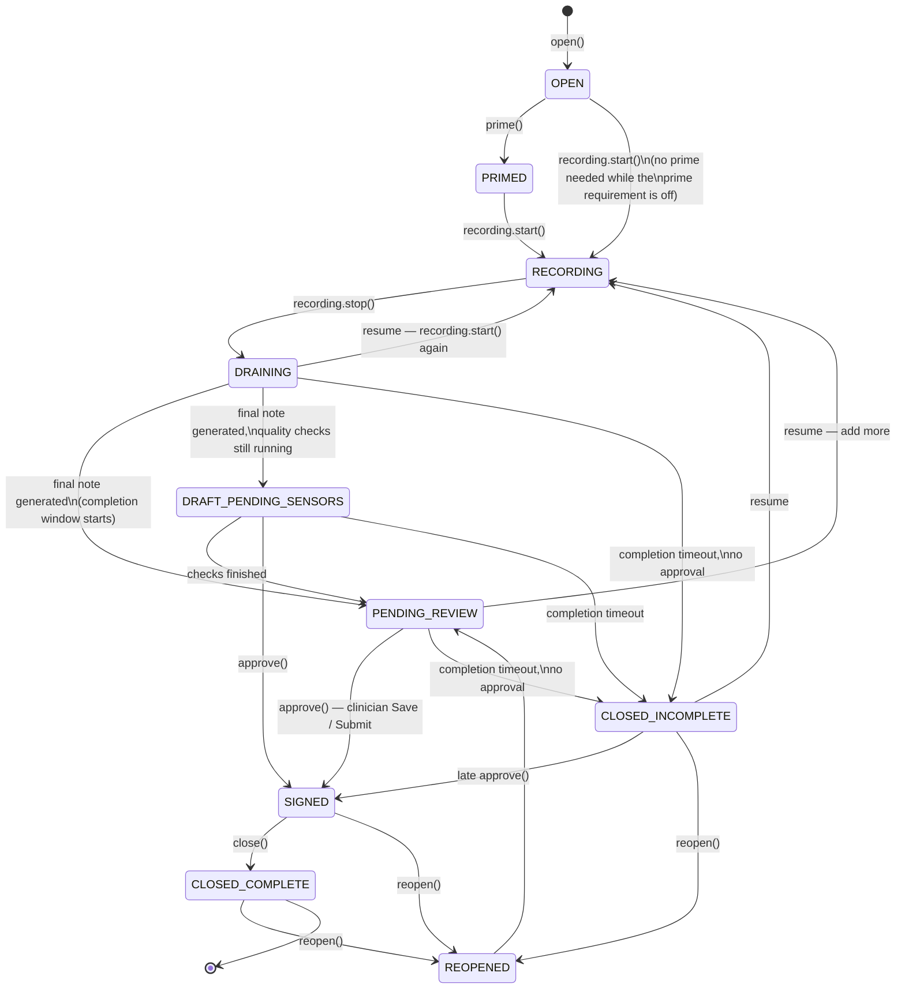
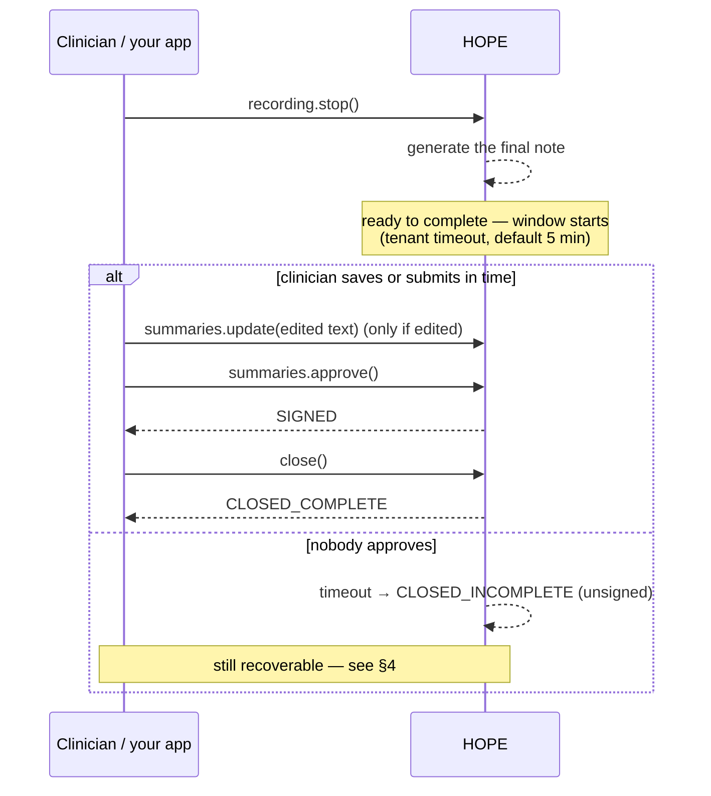

# Consultation Session Lifecycle

How a HOPE consultation moves from "open" to "done", what your integration sends at each step, and
what happens when nobody finishes it. For **tenant admins** who configure the behaviour and for
**integration engineers** who drive it from an EMR, a clinical app or a server.

Related guides: [Client-side Development & Integration Guide](client-integration-guide.md) (the SDK
calls in full) · [Tenant Admin User Guide](tenant-admin-user-guide.md) (the console).

---

## 1. The whole life in one picture



The short version:

1. **Open** a consultation, **record**, **stop**.
2. HOPE writes the **final note**. The consultation is now **ready to complete**, and a timer starts.
3. The clinician **approves** the note (in ALaaS: _Save_ or _Submit_, edited or as generated). HOPE
   signs it, your integration **closes** it: `CLOSED_COMPLETE`.
4. If nobody approves within the tenant's **completion timeout** (5 minutes unless your tenant admin
   changed it), HOPE closes the session **unsigned**: `CLOSED_INCOMPLETE`. That is not a dead end —
   a later approval still signs it, and the clinician can resume recording.

---

## 2. The states

| State                   | What it means                                                                                                           | How it gets here                | What can happen next                                                                                         |
| ----------------------- | ----------------------------------------------------------------------------------------------------------------------- | ------------------------------- | ------------------------------------------------------------------------------------------------------------ |
| `OPEN`                  | The consultation exists; nothing recorded yet.                                                                          | `open()`                        | `prime`, `recording.start`, or closed by the idle sweep                                                      |
| `PRIMED`                | Context is loaded and the session is ready to record.                                                                   | `prime()`                       | `recording.start`                                                                                            |
| `RECORDING`             | Audio is streaming; the live note is being written.                                                                     | `recording.start()`             | `recording.stop`                                                                                             |
| `DRAINING`              | Recording stopped; the final note is being produced.                                                                    | `recording.stop()`              | resume (`RECORDING`), the final note (`PENDING_REVIEW` / `DRAFT_PENDING_SENSORS`), or the completion timeout |
| `DRAFT_PENDING_SENSORS` | The final note is readable, quality checks are still running.                                                           | final note, optimistic delivery | `PENDING_REVIEW`, `approve`, the completion timeout                                                          |
| `PENDING_REVIEW`        | **Ready to complete**: the final note waits for the clinician's approval.                                               | final note                      | `approve` → `SIGNED`, resume (`RECORDING`), or the completion timeout                                        |
| `SIGNED`                | A clinician attested the note.                                                                                          | `approve()`                     | `close` → `CLOSED_COMPLETE`, `reopen`                                                                        |
| `CLOSED_COMPLETE`       | Done: signed and closed.                                                                                                | `close()` after `SIGNED`        | `reopen`                                                                                                     |
| `CLOSED_INCOMPLETE`     | Closed **unsigned** — the completion timeout ran out, an idle sweep closed it, or someone closed it without a sign-off. | timeout / sweep / `close()`     | late `approve` → `SIGNED`, resume (`RECORDING`), `reopen`                                                    |
| `TIMED_OUT`             | Legacy review timeout (the review sweep, see §7). Recoverable.                                                          | review sweep                    | `approve` → `SIGNED`, `close`, `reopen`                                                                      |
| `REOPENED`              | A signed or closed consultation opened again for review.                                                                | `reopen()`                      | `PENDING_REVIEW`, or closed by the idle sweep                                                                |

A transition that is not in the picture is refused with **409** and a message naming both states.
One platform switch relaxes this for recording only: while _require PRIMED before recording_
(`consultation.state.requirePrimedBeforeRecording`) is **off** — its default — `recording.start` is
accepted from any state and logged. Build your integration on the transitions in the picture; they
work whichever way the switch is set.

---

## 3. From "stop" to "done": the completion window

### When the clock starts

The completion window starts when **both** of these have happened:

1. the clinician **stopped recording** (`recording.stop`), and
2. HOPE **generated the final note** for that recording.

That is the moment the consultation becomes _ready to complete_. You can observe it three ways:

- the consultation's `status` becomes `PENDING_REVIEW` (or `DRAFT_PENDING_SENSORS`);
- `summaries.latest(id)` starts returning the note (before that it is a 404);
- the harness progress stream (`streams.harnessProgress`) sends its terminal event.

The window is held by HOPE's gateway, so it applies to every consultation whichever engine wrote
the note — the tenant's own workflow graph or HOPE's default documentation workflow. Starting to
record again **cancels** it (the consultation is no longer ready to complete); the note produced when
that recording stops starts a new one.

> A tenant workflow can also contain its own **review** step (a `core.humanReview` node). That is a
> step of the workflow, released by `hope.workflows.reviews.decide` (ALaaS releases it automatically
> on the clinician's behalf); it is not the clinician's sign-off and does not stop the completion
> window. The sign-off is `summaries.approve`.

### What ends it

| Outcome       | Trigger                                                                                                                                               | Result                                                              |
| ------------- | ----------------------------------------------------------------------------------------------------------------------------------------------------- | ------------------------------------------------------------------- |
| **Approved**  | `summaries.approve(consultationId, summaryId, …)` — in ALaaS, the clinician clicks **Save** or **Submit** on the final summary, with or without edits | `SIGNED`; your integration then calls `close()` → `CLOSED_COMPLETE` |
| **Timed out** | No approval within the tenant's completion timeout                                                                                                    | `CLOSED_INCOMPLETE` — closed, unsigned                              |



### A late approval still signs

If the clinician saves after the window closed, run the same sequence — update (if edited),
approve, close. HOPE accepts `CLOSED_INCOMPLETE → SIGNED`, and `close()` then lands on
`CLOSED_COMPLETE`. Nothing needs reopening first. (`close()` on a consultation that is already
closed is answered, not refused, so a double-click is harmless.)

### How ALaaS maps to this

| Clinician action in ALaaS                | Calls to HOPE                                                                   |
| ---------------------------------------- | ------------------------------------------------------------------------------- |
| **Save** on the final summary            | `summaries.update` (only when the text changed) → `summaries.approve` → `close` |
| **Save & copy to EMR** / **Copy to EMR** | the same three calls, after the EMR accepted the note                           |
| Resume recording                         | `recording.start` on the same consultation (see §4)                             |

ALaaS sends these fire-and-forget after its own save succeeded, and treats "already signed" /
"already closed" as success, so repeating a Save is safe.

---

## 4. Resuming and continuing

A consultation is not finished just because the clinician stopped once.

- **Stop, then record again.** `recording.start()` on a stopped consultation resumes it — while the
  final note is still being written (`DRAINING`) or once it is ready (`PENDING_REVIEW`). When that
  recording stops, HOPE
  **re-generates the final note over the whole visit** — every recording so far, in order — and
  replaces the unsigned draft in place (the same summary id). The completion window **starts
  again** from that moment.
- **Resume after the timeout.** A `CLOSED_INCOMPLETE` consultation can be resumed the same way:
  `recording.start()` moves it to `RECORDING`, and the next stop re-finalises and restarts the window.
- **Continue without recording.** Adding context, editing the summary and approving all work on a
  `CLOSED_INCOMPLETE` consultation.
- **A signed note is never replaced automatically.** Once a note is `SIGNED` (or `CLOSED_COMPLETE`),
  a later recording does not overwrite it. To change a signed note, `reopen()` it for review.

`open()` is get-or-create on patient, appointment date and clinician, so opening "again" returns the
same consultation — whatever its state — rather than creating a second one.

---

## 5. Configuring the completion timeout

The timeout is a **setting**, visible where every other tenant setting is.

|                    | Where                                                                                            | What you do                                                                                                                        |
| ------------------ | ------------------------------------------------------------------------------------------------ | ---------------------------------------------------------------------------------------------------------------------------------- |
| **Tenant admin**   | Console → **Settings** → _Consultation Pipeline_ → **Consultation completion timeout (minutes)** | Set your tenant's value. Your value wins for your tenant. **Reset** removes it and your tenant follows the platform default again. |
| **Platform admin** | Console → **Settings** → the same key, at **platform** scope                                     | Set the default every tenant without its own value falls back to.                                                                  |

- Key: `consultation.session.completionTimeoutMinutes`
- Whole minutes, **1 – 10 080** (7 days). Platform default: **5**.
- Resolution: the tenant's value → the platform's value → 5.
- A change applies to consultations that become _ready to complete_ **after** the change; a window
  that is already running keeps the duration it started with.

By API (admin plane: a tenant admin's session or a service account with `svc:admin:settings:manage`):

```http
GET    /api/v1/admin/settings/registry/consultation.session.completionTimeoutMinutes?scope=tenant
PUT    /api/v1/admin/settings/registry/consultation.session.completionTimeoutMinutes
       { "value": 10, "scope": "tenant" }          # If-Match: the version from the GET, once a value exists
DELETE /api/v1/admin/settings/registry/consultation.session.completionTimeoutMinutes?scope=tenant
       # reset: follow the platform default again
```

The **Harness Policy** screen shows the effective timeout read-only ("completion timeout · set in
Settings"); it is not edited there.

---

## 6. What your integration sends and receives

| You call                                                             | Legal from                                                                                                                                                                  | Gives you                                     |
| -------------------------------------------------------------------- | --------------------------------------------------------------------------------------------------------------------------------------------------------------------------- | --------------------------------------------- |
| `consultations.open(…)`                                              | —                                                                                                                                                                           | the consultation (existing one if it matches) |
| `recording.start(id, { sessionId })`                                 | `PRIMED`, `DRAINING`, `PENDING_REVIEW`, `CLOSED_INCOMPLETE` always; any other state only while the platform's _require PRIMED before recording_ switch is off (its default) | `RECORDING`                                   |
| `recording.stop(id)`                                                 | `RECORDING`                                                                                                                                                                 | `DRAINING`; the final note follows            |
| `summaries.latest(id)`                                               | once the final note exists                                                                                                                                                  | the note, its `id` and `version`              |
| `summaries.update(id, summaryId, { content })`                       | an unsigned note                                                                                                                                                            | a new version of the note                     |
| `summaries.approve(id, summaryId, { clinicianUserId }, { ifMatch })` | `PENDING_REVIEW`, `DRAFT_PENDING_SENSORS`, `TIMED_OUT`, `CLOSED_INCOMPLETE`                                                                                                 | `SIGNED`                                      |
| `consultations.close(id, …, { ifMatch })`                            | `SIGNED` → `CLOSED_COMPLETE`; `TIMED_OUT` → `CLOSED_INCOMPLETE`; already closed → returned as is                                                                            | the closed consultation                       |
| `consultations.reopen(id)`                                           | `SIGNED`, `TIMED_OUT`, `CLOSED_COMPLETE`, `CLOSED_INCOMPLETE`                                                                                                               | `REOPENED`                                    |

Streams you can subscribe to while a consultation is live: `streams.liveSummary` (the live note,
section by section), `streams.harnessProgress` (final-note generation; its terminal event means the
note is ready), `streams.liveAssist`, `streams.loop`. See the
[integration guide, chapter 6](client-integration-guide.md#6-live-summary-and-events).

`approve` and `close` use optimistic concurrency: pass the row's `version` as `ifMatch` (missing →
428, stale → 412 — re-read and retry). A service-account caller must name `clinicianUserId`; the
clinician is the one attested, never the service account.

---

## 7. The other timers

The completion timeout is the one that matters day to day. These platform timers exist too; they
catch sessions that were abandoned **before** they became ready to complete. All are platform
settings (Settings → _Consultation Pipeline_), checked every 15 minutes.

| Timer                                                                                 | Default                    | Applies to                                                                              | Result                                                           |
| ------------------------------------------------------------------------------------- | -------------------------- | --------------------------------------------------------------------------------------- | ---------------------------------------------------------------- |
| **Consultation completion timeout** (`consultation.session.completionTimeoutMinutes`) | **5 min**, tenant-editable | ready to complete (final note generated), not approved                                  | `CLOSED_INCOMPLETE`                                              |
| Recording stale (`consultation.state.recordingStaleMinutes`)                          | 30 min                     | `RECORDING` with no live audio                                                          | stopped → `DRAINING`                                             |
| Open idle (`consultation.state.openTimeoutMinutes`)                                   | 120 min                    | `OPEN`, never recorded                                                                  | `CLOSED_INCOMPLETE`                                              |
| Review idle (`consultation.state.reviewTimeoutMinutes`)                               | 120 min                    | `PENDING_REVIEW` with no activity                                                       | `TIMED_OUT` (in practice the completion timeout closes it first) |
| Session idle (`consultation.state.sessionTimeoutMinutes`)                             | 24 h                       | `PRIMED`, `DRAINING`, `DRAFT_PENDING_SENSORS`, `TIMED_OUT`, `REOPENED` with no activity | `CLOSED_INCOMPLETE`                                              |

---

## 8. Troubleshooting

| Symptom                                                                       | Cause                                                                                                                                                                 | What to do                                                                                                                 |
| ----------------------------------------------------------------------------- | --------------------------------------------------------------------------------------------------------------------------------------------------------------------- | -------------------------------------------------------------------------------------------------------------------------- |
| Consultations end up `CLOSED_INCOMPLETE` a few minutes after the doctor stops | Nobody approved inside the completion timeout                                                                                                                         | Make sure Save / Submit calls `approve` (ALaaS does); raise the timeout in Settings if clinicians routinely review longer  |
| `approve` answers 409                                                         | The consultation is in a state approve does not accept (e.g. still `RECORDING`, or already `SIGNED`)                                                                  | Stop the recording first; "already signed" is success for a retry                                                          |
| The final note does not include what was said after a resume                  | The note is re-generated when the **resumed recording stops**, not while it runs                                                                                      | Stop the recording; read `summaries.latest` again after the harness progress stream finishes                               |
| A resumed recording did not change the note                                   | The note was already `SIGNED` — signed notes are never replaced                                                                                                       | `reopen()` for review, or start a new consultation for a new encounter                                                     |
| `recording.start` answers 409                                                 | The platform's _require PRIMED before recording_ switch is on and the consultation is in a state that cannot resume (for example `OPEN` without `prime`, or `SIGNED`) | `prime()` first for a new consultation; `reopen()` a signed one for review, or open a new consultation for a new encounter |
| The timeout I set does not seem to apply                                      | The running window started before your change, or your tenant has no own value and follows the platform                                                               | Check the value at _tenant_ scope in Settings; new windows use the new value                                               |
