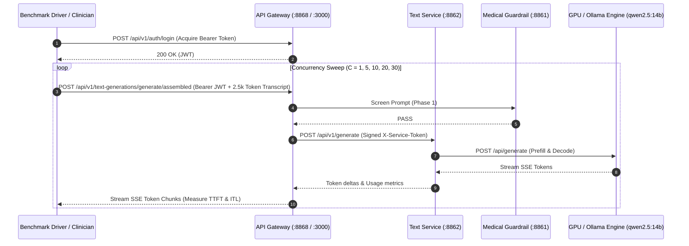

# LLM Gateway Latency & Concurrency Benchmark Suite

This benchmark suite measures the **end-to-end latency, throughput, and concurrency degradation** of the clinical LLM service on your GPU **through the API Gateway**, mirroring production clinician usage.



---

## 1. Metrics Tracked ("Golden Signals")

| Metric | Target / SLA | Description |
|---|---|---|
| **TTFT (Time to First Token)** | `< 1.2s` | Time from HTTP dispatch until the first token chunk reaches the client. Measures prompt prefill & gateway auth latency. |
| **ITL / TPOT (Inter-Token Latency)** | `< 35ms` (>28 tok/s) | Gap between consecutive streaming chunks. Measures decode performance on GPU. |
| **E2E Request Latency** | `< 12s` | Total duration to stream the full ~1,500 token clinical SOAP note. |
| **Gateway Overhead** | `< 45ms` | `Client TTFT - Engine TTFT`. Measures NestJS auth, serialization, and proxying cost. |
| **GPU VRAM & Compute** | `< 90% VRAM` | GPU memory utilization and compute saturation via `nvidia-smi`. |
| **Resilience & Error Rate** | `0%` | Frequency of 429 (Rate-limited), 503 (Semaphore full), 504 (Timeout), or 500 (OOM). |

---

## 2. Directory Contents

* **`README.md`**: Architecture, metrics definition, and runbook (this document).
* **`STAGE_MEASUREMENT_METHODOLOGY.md`**: Detailed technical specifications and mathematical derivations for the **10 pipeline stages** (Auth, Assembly, Redis, Guardrails, Queue, GPU Prefill, GPU Decode, Schema Gate, Chunk Relay, E2E).
* **`benchmark_report.md`**: Executive summary and comparison report between models and concurrency tiers.
* **`sample_clinical_transcript.json`**: Realistic ~2,500 token clinical consultation dialogue payload.
* **`gateway_load_test.py`**: Locust test suite driving concurrent clinician users through the API Gateway with SSE stream measurement.
* **`run_concurrency_sweep.py`**: Automated test runner that sweeps concurrency ($C = 1, 5, 10, 20, 30$), captures percentiles, and outputs a comparison table.
* **`gpu_monitor.sh`**: Real-time GPU metrics logger (VRAM, compute %, temperature) outputting to CSV.

---

## 3. Prerequisites

1. **Python dependencies**:
   ```bash
   pip install requests locust httpx sseclient-py
   ```
2. **Services running**:
   * **API Gateway** running on port `3000` or `8868`.
   * **Text Service** (`apps/text`) running on port `8862`.
   * **LLM Engine** (Ollama / vLLM) loaded with `qwen2.5:14b` on the target GPU.

---

## 4. Execution Guide

### Option A: Automated Multi-Level Sweep with Remote GPU Telemetry (Recommended)

Once passwordless SSH is configured for `vidit@192.168.112.2`:
```bash
# 1. One-time setup: copy your public key to the GPU host
ssh-copy-id vidit@192.168.112.2

# 2. Run benchmark (automatically starts & stops remote nvidia-smi over SSH)
python3 run_concurrency_sweep.py \
  --gateway-url https://api-vox2.arcaai.com \
  --gpu-ssh vidit@192.168.112.2 \
  --email doctor.test@example.com \
  --password 'Password123!' \
  --levels 1,5,10,20,30 \
  --requests-per-level 20 \
  --output-report benchmark_results.json
```

### Option B: Interactive Real-Time Load Testing (Locust)

Launch the interactive Locust dashboard:

```bash
GATEWAY_URL="http://localhost:3000" \
DOCTOR_EMAIL="doctor.test@example.com" \
DOCTOR_PASSWORD="Password123!" \
locust -f gateway_load_test.py --host http://localhost:3000
```
Open **`http://localhost:8089`** in your browser to inspect real-time RPS, latency graphs, and failure rates.

---

## 5. Interpreting Results

* **Knee of the Curve:** The concurrency level where TTFT transitions from a flat line into linear or exponential growth indicates GPU KV-cache queuing.
* **Gateway Saturation vs. GPU Saturation:** If GPU compute is `< 70%` but Gateway latencies spike, check Gateway HTTP connection pool limits (`maxSockets`) and Node.js event-loop lag.
* **Circuit Breakers:** If 503s appear with `Retry-After: 5`, `apps/text` concurrency semaphores are successfully shielding the GPU from Out-of-Memory crashes.
