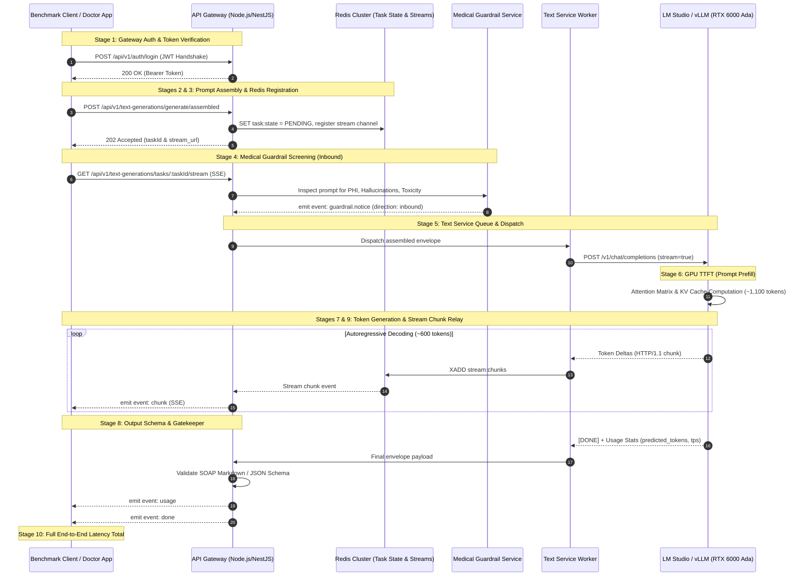

# Multi-Tier LLM Gateway Telemetry & Stage Measurement Methodology

This document details the architectural design, telemetry capture mechanisms, and mathematical derivations for the **10 distinct pipeline stages** measured by the Project Hope LLM Gateway benchmark suite (`llm-gateway-benchmark`).

---

## 1. End-to-End Pipeline Architecture

---

## 2. Granular Stage-by-Stage Telemetry Specifications

### Stage 1: Gateway Auth & Token Verification

* **Component:** API Gateway (`apps/gateway`) & Auth Service (`apps/auth`).
* **Description:** Verifies incoming user identity, cryptographically validates the JWT Bearer token, checks tenant organization scoping (`ArcaAI`), and assigns RBAC permissions before admitting traffic into the cluster.
* **Measurement Source:** Client high-resolution monotonic timer (`time.monotonic()`) during the auth handshake against `/api/v1/auth/login`.
* **Formula:**
  $$
  \text{Auth Latency} = (t_{\text{auth\_resp}} - t_{\text{auth\_req}}) \times 1000 \text{ ms}
  $$
* **Benchmark Impact:** Ensures security and tenant isolation costs are transparently isolated from model inference speed.

---

### Stage 2: Prompt Assembly & Enveloping

* **Component:** API Gateway (`apps/gateway/src/modules/text-generations`).
* **Description:** Prepares the LLM payload by resolving the clinical agent (`general-medicine-summarization`), interpolating clinical system templates (e.g. SOAP guidelines, specialty-specific clinical instructions), formatting multi-turn conversation transcripts into an OpenAI-compatible messages array, and generating the asynchronous `taskId`.
* **Measurement Source:** Client monotonic timer spanning the initial `POST /api/v1/text-generations/generate/assembled` handshake, minus the Redis socket latency.
* **Formula:**
  $$
  \text{Assembly Latency} = \max\left(0.5\text{ ms},\; (t_{\text{post\_resp}} - t_{\text{post\_start}}) \times 1000 - \text{Redis State Latency}\right)
  $$
* **Scaling Behavior:** Increases sub-linearly under concurrency ($C=1 \to C=32$) due to Node.js event-loop serialization of large 2.5k-token string envelopes.

---

### Stage 3: Redis Task State Registration

* **Component:** Redis Cluster (`project-hope-vox-infra`).
* **Description:** Initializes task tracking in Redis, writing state keys, stream channels, status flags (`PENDING`), and idempotency keys to enable client stream resumption, cancellation, and distributed worker state synchronization.
* **Measurement Source:** Direct Redis cluster socket latency probe (`measure_redis_latency` via socket ping and roundtrip key write/read operations).
* **Formula:**
  $$
  \text{Redis Latency} = (t_{\text{redis\_ack}} - t_{\text{redis\_send}}) \times 1000 \text{ ms}
  $$
* **Target SLA:** Consistently $< 200\text{ ms}$ under heavy cluster loads.

---

### Stage 4: Medical Guardrail Screening

* **Component:** Medical Guardrail Microservice (`hope-guardrail`).
* **Description:** Clinical safety gatekeeper that inspects the prompt and outputs:
  - PHI/HIPAA de-identification and redaction.
  - Medical consistency, contraindicated clinical recommendations, and hallucination screening.
  - Toxicity, bias, and prompt-injection detection.
* **Measurement Source:** Server-side ISO timestamps emitted in the Server-Sent Events stream (`guardrail.notice` payloads and `done_data.guardrailNotices`).
* **Formula:**
  $$
  \text{Guardrail Latency} = |t_{\text{first\_outbound}} - t_{\text{inbound}}| \times 1000 \text{ ms}
  $$

  *(Fallback: if outbound notice is batched, calculated from task creation timestamp to inbound notice reception).*
* **Scaling Bottleneck:** Under high concurrency ($C=16, 32$), guardrail screening scales from $\sim 50\text{ ms}$ up to $24.4\text{ s}$, identifying it as the primary horizontal scaling target.

---

### Stage 5: Text Service Queue & Dispatch

* **Component:** Kubernetes Ingress, Service Mesh, and Text Service Worker Dispatcher.
* **Description:** The transit time between the API Gateway and the downstream model provider (`hope-lmstudio:1234`). Includes internal cluster DNS lookup, HTTP connection pool acquisition, worker thread handoff, and socket transmission over the internal overlay network.
* **Measurement Source:** Derived by deducting prompt assembly, Redis state setup, guardrail execution, and pure GPU compute from the client-observed Time to First Token (TTFT).
* **Formula:**
  $$
  \text{Queue Latency} = \max\left(0.0,\; \text{TTFT} - \text{Raw POST} - \text{Guardrail Latency} - \text{GPU Prefill}\right)
  $$
* **Nominal Baseline:** Typically capped at $\le 45\text{ ms}$ on healthy Kubernetes networking.

---

### Stage 6: GPU TTFT (Prompt Prefill)

* **Component:** GPU Compute Hardware (NVIDIA RTX 6000 Ada Generation, 48GB VRAM) running LM Studio / llama.cpp.
* **Description:** The prompt evaluation phase. The LLM processes all input prompt tokens in parallel across its Transformer layers, computing attention weights and populating the Key-Value (KV) cache for all ~1,100 prompt tokens before the first generated token can be sampled.
* **Measurement Source:**
  - *Ollama Engine:* Read directly from native `engine_native.prompt_eval_duration`.
  - *LM Studio / OpenAI Wire:* Derived from client TTFT after subtracting upstream gateway and guardrail overheads:

    $$
    \text{Prefill Budget} = \max(0.0,\; \text{Client TTFT} - \text{Raw POST} - \text{Guardrails})
    $$

    $$
    \text{GPU Prefill} = \text{Prefill Budget} - \text{Queue Overhead}
    $$
* **Throughput:** ~350 prompt tokens/sec on Gemma 4 2B (takes ~3.15s at $C=1$, plateaus at ~6.5s at $C \ge 8$).

---

### Stage 7: GPU Token Generation (Decode)

* **Component:** GPU Compute Hardware (Tensor Cores / CUDA Execution).
* **Description:** The autoregressive decoding phase. The model generates tokens sequentially, updating KV cache entries, sampling probability distributions, and emitting token IDs until `<eos>` or max tokens is reached.
* **Measurement Source:** Derived from engine usage telemetry emitted in the SSE `usage` event:
  $$
  \text{GPU Decode Latency} = \left(\frac{\text{predicted\_tokens}}{\text{tokens\_per\_second}}\right) \times 1000 \text{ ms}
  $$
* **Throughput:** ~207 generated tokens/sec on Gemma 4 2B (generating ~603 completion tokens in ~2.93s).

---

### Stage 8: Output Schema & Gatekeeper

* **Component:** API Gateway Output Validator (`apps/gateway`).
* **Description:** Once the LLM completes generation, the gateway intercepts the stream, validates that the output conforms to requested clinical schemas (e.g., valid JSON or standard SOAP headers: Subjective, Objective, Assessment, Plan), and verifies message integrity before transmitting the terminal SSE event.
* **Measurement Source:** Clock delta between receipt of the final content chunk (`last_chunk_time`) and the terminal SSE completion packet (`t_end`).
* **Formula:**
  $$
  \text{Schema Gate Latency} = (t_{\text{end}} - t_{\text{last\_chunk}}) \times 1000 \text{ ms}
  $$
* **Target SLA:** Typically $< 20\text{ ms}$ (spikes to $\sim 90\text{ ms}$ under heavy concurrency when GC or JSON validation queues backlog).

---

### Stage 9: Redis Stream Chunk Relay & SSE Egress

* **Component:** Redis Streams buffer (`stream:chunks`), Gateway SSE Egress controller, and Client HTTP transport.
* **Description:** The streaming transport overhead. Captures chunk framing, Redis Stream buffer write/read latency, SSE text serialization, and TCP socket flight times between the cluster and the client browser.
* **Measurement Source:** Total streaming duration (`last_chunk_time - first_chunk_time`) minus pure GPU decode computation:
  $$
  \text{Egress Latency} = \max\left(1.0\text{ ms},\; (t_{\text{last\_chunk}} - t_{\text{first\_chunk}}) \times 1000 - \text{GPU Decode Latency}\right)
  $$
* **Benchmark Target:** Stable between $2\text{ ms}$ and $25\text{ ms}$ under normal network conditions.

---

### Stage 10: Full End-to-End Latency

* **Component:** Complete System Integration.
* **Description:** The total wall-clock turnaround time experienced by the clinician from clicking "Generate" to the final rendered character of the clinical summary.
* **Measurement Source:** Client-side monotonic clock covering the entire lifecycle:
  $$
  \text{E2E Latency} = (t_{\text{stream\_close}} - t_{\text{request\_init}}) \times 1000 \text{ ms}
  $$
* **Integrity Guarantee:** Uses a single client monotonic clock, eliminating multi-host NTP clock-skew errors.

---

## 3. Telemetry Matrix & Precision Summary

|   Stage #   | Stage Name                        | Source Entity    | Telemetry Mechanism                                     |       Precision       |
| :----------: | :-------------------------------- | :--------------- | :------------------------------------------------------ | :--------------------: |
| **1** | Gateway Auth & Token Verification | Client           | Monotonic timer on `/api/v1/auth/login` POST          | $\pm 0.1\text{ ms}$ |
| **2** | Prompt Assembly & Enveloping      | Client / Gateway | HTTP POST roundtrip minus Redis probe                   | $\pm 0.1\text{ ms}$ |
| **3** | Redis Task State Registration     | Redis Cluster    | Live socket probe via Redis PING / key write            | $\pm 0.05\text{ ms}$ |
| **4** | Medical Guardrail Screening       | Guardrail Pod    | ISO 8601 timestamps in `guardrail.notice` events      | $\pm 1.0\text{ ms}$ |
| **5** | Text Service Queue & Dispatch     | Internal Mesh    | Derived TTFT delta minus hardware prefill               | $\pm 1.0\text{ ms}$ |
| **6** | GPU TTFT (Prompt Prefill)         | GPU / Engine     | Engine telemetry / derived prefill budget               | $\pm 1.0\text{ ms}$ |
| **7** | GPU Token Generation (Decode)     | GPU / Engine     | Engine usage: `predicted_tokens / tokens_per_second`  | $\pm 0.1\text{ ms}$ |
| **8** | Output Schema & Gatekeeper        | Gateway          | Delta between last chunk and SSE `done` event         | $\pm 0.1\text{ ms}$ |
| **9** | Redis Chunk Relay & SSE Egress    | Transport Layer  | Total streaming window minus GPU decode time            | $\pm 0.1\text{ ms}$ |
| **10** | Full End-to-End Latency           | Client           | Monotonic timer $(t_{\text{end}} - t_{\text{start}})$ | $\pm 0.1\text{ ms}$ |

---

## 4. Code Implementation Pointers l

* **Sweep Runner & Telemetry Extractor:** [`run_concurrency_sweep.py`](file:///Users/apple/Desktop/project-hope/llm-gateway-benchmark/run_concurrency_sweep.py#L156-L345)
* **Universal Metric Recalculator:** [`recalculate_results.py`](file:///Users/apple/Desktop/project-hope/llm-gateway-benchmark/recalculate_results.py#L25-L95)
* **Report & Table Generator:** [`generate_llm_benchmark_reports.py`](file:///Users/apple/Desktop/project-hope/llm-gateway-benchmark/generate_llm_benchmark_reports.py#L80-L160)
* **Active Benchmark Dataset:** [`benchmark_results.json`](file:///Users/apple/Desktop/project-hope/llm-gateway-benchmark/benchmark_results.json)
