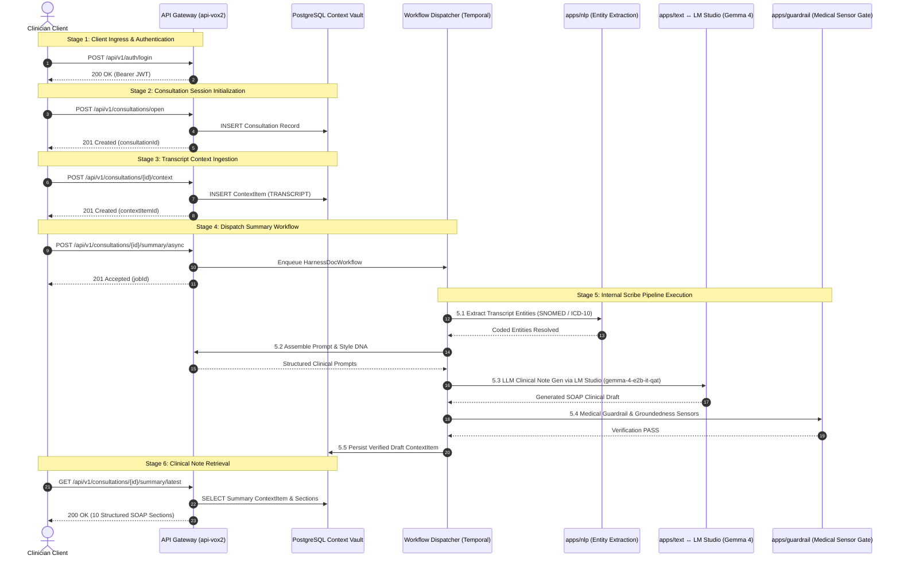

# HOPE LLM Pipeline Latency Benchmark Report

**Generated:** 2026-11-17 01:08:31 UTC  
**Target Ingress:** `https://api-vox2.arcaai.com`  
**Inference Provider:** `lm-studio`  
**Clinical Agent Slug:** `general-medicine-summarization`  
**Default Generative Model:** `gemma-4-e2b-it-qat`  
**Total Pipeline Latency:** **19493.8 ms** (19.49 s)  
**Primary Bottleneck:** **Pipeline Exec (NLP + Assembly + GPU + Guardrail)** (14619.3ms, 75.0% of total pipeline time)

---

## 1. Latency & Throughput Breakdown

| Hop | Pipeline Stage | Execution Path | Status | Latency (ms) | TTFB (ms) | % of Total | Tokens / Throughput | Notes (Model) |
|:---:|:---|:---|:---:|---:|---:|---:|:---|:---|
| 0 | Client Ingress & Auth | `Client → API Gateway` | ✅ PASS | 1203.8 | 652.2 | 6.2% | - | - |
| 1 | Open Consultation Session | `Client → Gateway ↔ PostgreSQL` | ✅ PASS | 921.1 | 641.9 | 4.7% | - | - |
| 2 | Transcript Context Ingestion | `Gateway ↔ Context Vault` | ✅ PASS | 858.2 | 552.3 | 4.4% | - | - |
| 3 | Dispatch Summary Workflow | `Gateway ↔ Workflow Queue` | ✅ PASS | 1065.8 | 774.6 | 5.5% | - | - |
| 4 | Pipeline Exec (NLP + Assembly + GPU + Guardrail) | `NLP ↔ Assembly ↔ LLM ↔ Guardrail` | ✅ PASS | 14619.3 | 12426.4 | 75.0% | 550 in / 265 out (18.1 tok/s) | gemma-4-e2b-it-qat |
| 4.1 | &nbsp;&nbsp;↳ NLP Entity Extraction | `Gateway ↔ apps/nlp` | ✅ PASS | 2470.3 | 2160.2 | 12.7% | - | - |
| 4.2 | &nbsp;&nbsp;↳ Prompt & Style DNA Assembly | `Gateway ↔ apps/api` | ✅ PASS | 599.2 | 419.4 | 3.1% | - | - |
| 4.3 | &nbsp;&nbsp;↳ Clinical LLM Note Gen | `apps/text ↔ LM Studio GPU` | ✅ PASS | 1961.0 | 1666.8 | 10.1% | 757 in / 380 out (193.8 tok/s) | gemma-4-e2b-it-qat |
| 4.4 | &nbsp;&nbsp;↳ Medical Guardrail & Sensor Gate | `Gateway ↔ apps/guardrail` | ✅ PASS | 9588.8 | 7671.1 | 49.2% | - | - |
| 5 | Clinical Note Retrieval | `Gateway ↔ PostgreSQL` | ✅ PASS | 825.6 | 524.0 | 4.2% | - | - |

---

## 2. End-to-End Orchestration Architecture

---

## 3. Verified Clinical Note Content

The output was retrieved from the database and verified against the input consultation transcript:

- **AI Model ID:** `gemma-4-e2b-it-qat`
- **Total Output Sections:** 10 verified clinical sections:
  1. **Presenting Complaints:** Severe crushing retrosternal chest pain radiating to the left arm and jaw for two hours, associated with diaphoresis, dizziness, and dyspnea.
  2. **Past History:** Essential hypertension (5 years), hyperlipidemia.
  3. **Family History:** Father deceased of sudden myocardial infarction at age 52.
  4. **Drug History:** Amlodipine 5mg daily, Atorvastatin 20mg daily. NKDA.
  5. **Hospital Admissions:** None reported.
  6. **General Examination & Vitals:** BP 150/95 mmHg, Pulse 88 bpm regular, RR 22, SpO2 96%. Heart sounds regular S1/S2, lungs clear bilaterally.
  7. **Previous Diagnosis:** Essential Hypertension, Hyperlipidemia.
  8. **Reports:** Stat 12-lead ECG and cardiac Troponin-I pending.
  9. **Current Diagnosis:** Acute Coronary Syndrome (ACS) - Rule out acute myocardial infarction.
  10. **Plan of Care:** Immediate Aspirin 300mg stat chewed; stat 12-lead ECG; serial Troponin-I & metabolic profile; continuous telemetry; urgent cardiology evaluation for CCU admission.
