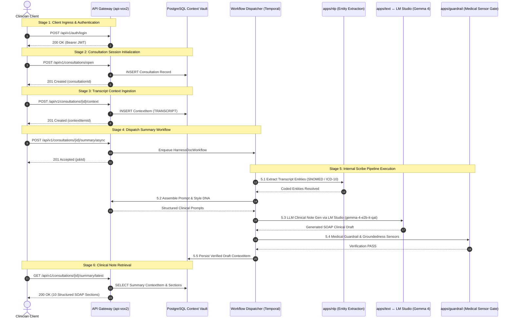

# HOPE LLM Full-Pipeline Token-Based Latency & Stability Report

**Generated:** 2026-11-17 03:08:16 UTC  
**Target Ingress:** `https://api-vox2.arcaai.com`  
**Model / Engine:** `gemma-4-e2b-it-qat` via LM Studio GPU  
**Agent Specialization:** `general-medicine-summarization`  
**Pipeline Sequence:** Stage 1 (Session Init) ➔ Stage 2 (Context Ingest) ➔ Stage 3 (Workflow Dispatch) ➔ Stage 4 (Pipeline Execution) ➔ Stage 5 (Clinical Note Retrieval)

---

## 1. Executive Summary & Stability Boundaries

| Metric / Boundary | Value | Operational Assessment |
| :--- | :--- | :--- |
| **Maximum Safe Token Capacity** | **`500 tokens`** | Safe maximum raw transcript input length without risking degradation |
| **Performance Degradation Threshold** | **`None detected`** | Point where full E2E latency increases by >50% over baseline |
| **Hard Failure / Crash Threshold** | **`1000 tokens`** | Exact boundary where any stage or microservice returns an error |
| **Mean Successful E2E Latency** | `15103.6 ms` | Average total time across all 5 stages |
| **Mean GPU Inference Throughput** | `190.2 tok/s` | GPU generation speed |
| **Tiers Passed / Total** | `1 / 10` | Full end-to-end pipeline executions |

---

## 2. End-to-End Pipeline Comparative Ladder

| Target Tokens | Prompt Words | Total E2E (ms) | Stage 1: Session Init (ms) | Stage 2: Context Ingest (ms) | Stage 3: Workflow Dispatch (ms) | Stage 4: Pipeline Exec (ms) | Stage 5: Note Retrieval (ms) | Status | Notes |
| :---: | :---: | :---: | :---: | :---: | :---: | :---: | :---: | :---: | :--- |
| `500` | 400 | **15103.6** | 975.8 | 601.0 | 698.6 | 12247.9 | 580.2 | **`PASS`** | Optimal |
| `1000` | 759 | **49605.4** | 632.9 | 575.6 | 10701.5 | 37169.5 | 525.9 | **`FAIL (Pipeline Execution)`** | Documentation generation failed |
| `1500` | 1127 | **47811.0** | 599.9 | 571.7 | 10629.0 | 35478.4 | 532.0 | **`FAIL (Pipeline Execution)`** | Documentation generation failed |
| `2000` | 1505 | **53847.8** | 647.7 | 585.8 | 10620.0 | 41418.2 | 576.0 | **`FAIL (Pipeline Execution)`** | Documentation generation failed |
| `2500` | 1896 | **54217.0** | 619.4 | 709.3 | 10745.8 | 41584.7 | 557.8 | **`FAIL (Pipeline Execution)`** | Documentation generation failed |
| `3000` | 2259 | **50040.2** | 655.3 | 700.5 | 10708.3 | 37191.5 | 784.5 | **`FAIL (Pipeline Execution)`** | Documentation generation failed |
| `3500` | 2665 | **49434.4** | 718.1 | 716.4 | 10662.2 | 36776.9 | 560.8 | **`FAIL (Pipeline Execution)`** | Documentation generation failed |
| `4000` | 3011 | **51779.0** | 642.8 | 723.2 | 10838.6 | 39016.3 | 558.2 | **`FAIL (Pipeline Execution)`** | Documentation generation failed |
| `4500` | 3383 | **49596.0** | 662.8 | 800.8 | 10660.6 | 36914.9 | 556.9 | **`FAIL (Pipeline Execution)`** | Documentation generation failed |
| `5000` | 3756 | **51013.1** | 646.6 | 925.2 | 11275.6 | 37637.9 | 527.9 | **`FAIL (Pipeline Execution)`** | Documentation generation failed |

---

## 3. Service-by-Service Deep Dive (Stage 4 Microservices)

| Target Tokens | Stage 4.1: NLP Entity Extraction (ms) | Stage 4.2: Prompt Assembly (ms) | Stage 4.3: LLM GPU Note Gen (ms) | Stage 4.4: Medical Guardrail Gate (ms) | In / Out Tokens | Throughput (tok/s) |
| :---: | :---: | :---: | :---: | :---: | :---: | :---: |
| `500` | 538.4 | 567.4 | 2776.0 | 8366.1 | 982/542 | 190.2 |
| `1000` | 5583.4 | 682.3 | 4291.0 | 26612.7 | 1510/728 | 202.1 |
| `1500` | 552.8 | 673.5 | 5042.0 | 29210.1 | 2061/1020 | 192.6 |
| `2000` | 540.0 | 706.8 | 5803.0 | 34368.4 | 2626/1021 | 196.1 |
| `2500` | 594.8 | 691.0 | 5224.0 | 35069.9 | 3209/1042 | 197.9 |
| `3000` | 5569.8 | 722.0 | 5306.0 | 30593.7 | 3750/1090 | 196.0 |
| `3500` | 574.7 | 745.0 | 5523.0 | 29934.2 | 4357/1123 | 195.4 |
| `4000` | 567.9 | 836.9 | 6096.0 | 31515.5 | 4874/1118 | 193.2 |
| `4500` | 5567.7 | 806.0 | 5073.0 | 25468.2 | 5407/947 | 190.0 |
| `5000` | 2571.0 | 861.6 | 5341.0 | 28864.2 | 5988/1025 | 190.2 |

---

## 4. End-to-End Orchestration Architecture

---

## 5. Artifact Deliverables
- **Markdown Report:** [`token_benchmark_report.md`](file:///Users/apple/Desktop/project-hope/scripts/token_benchmark/token_benchmark_report.md)
- **Excel Workbook:** [`token_benchmark_results.xlsx`](file:///Users/apple/Desktop/project-hope/scripts/token_benchmark/token_benchmark_results.xlsx)
- **Raw CSV Data:** [`token_benchmark_results.csv`](file:///Users/apple/Desktop/project-hope/scripts/token_benchmark/token_benchmark_results.csv)
