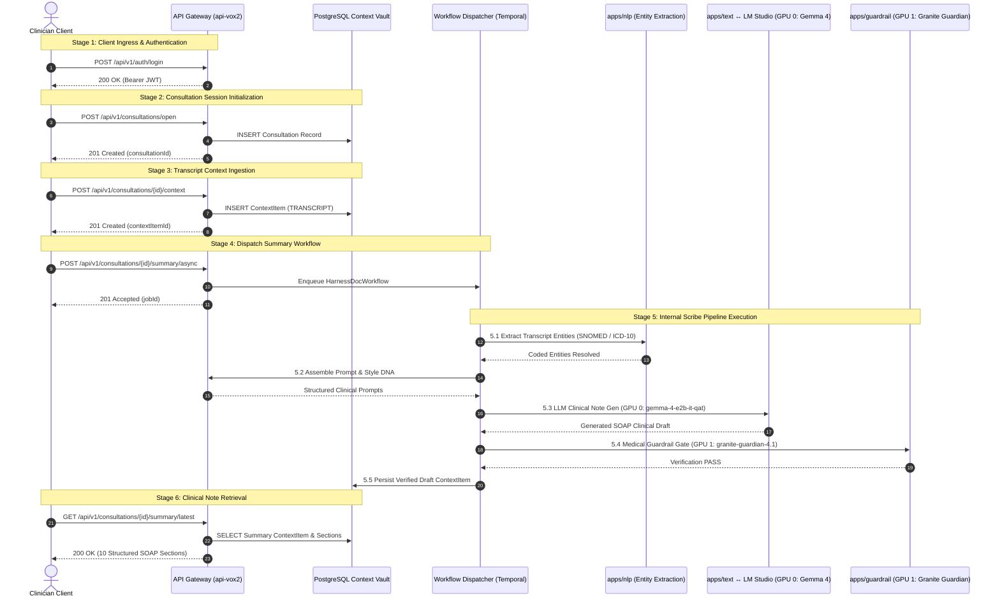

# HOPE LLM Full-Pipeline Token-Based Latency & Stability Report

**Generated:** 2026-11-25 08:49:10 UTC  
**Target Ingress:** `https://adminconsole-vox.arcaai.com`  
**Model / Engine:** `gemma-4-e2b-it-qat` via LM Studio GPU  
**Agent Specialization:** `hematology-summary-new-visit`  
**Pipeline Sequence:** Stage 1 (Session Init) ➔ Stage 2 (Context Ingest) ➔ Stage 3 (Workflow Dispatch) ➔ Stage 4 (Pipeline Execution) ➔ Stage 5 (Clinical Note Retrieval)

---

## 1. Executive Summary & Stability Boundaries

| Metric / Boundary | Value | Operational Assessment |
| :--- | :--- | :--- |
| **Maximum Safe Token Capacity** | **`9500 tokens`** | Safe maximum raw transcript input length without risking degradation |
| **Performance Degradation Threshold** | **`4500 tokens`** | Point where full E2E latency increases by >50% over baseline |
| **Hard Failure / Crash Threshold** | **`None (All Tiers Passed)`** | Exact boundary where any stage or microservice returns an error |
| **Mean Successful E2E Latency** | `34107.7 ms` | Average total time across all 5 stages |
| **Mean GPU Inference Throughput** | `195.0 tok/s` | GPU generation speed |
| **Tiers Passed / Total** | `17 / 20` | Full end-to-end pipeline executions |

---

## 2. End-to-End Pipeline & Microservice Comparative Ladder

| Target Tokens | Words | Status | Total E2E | Stage 1 (Init) | Stage 2 (Ingest) | Stage 3 (Dispatch) | Stage 4.1 (NLP) | Stage 4.2 (Grd In) | Stage 4.3 (Prompt) | Stage 4.4 (GPU Gen) | Stage 4.5 (Grd Out) | Stage 4 (Grd Tot) | Stage 4 (Total) | Stage 5 (Retrieve) | GPU Speed | Operational Assessment |
| :---: | :---: | :---: | :---: | :---: | :---: | :---: | :---: | :---: | :---: | :---: | :---: | :---: | :---: | :--- |
| `500` | 400 | **`PASS`** | **26.93s** | 733ms | 713ms | 816ms | 718ms | 3.58s | 750ms | 3.20s | 15.81s | 19.39s | 24.06s | 608ms | 195.0 tok/s | Success (Optimal) |
| `1000` | 759 | **`PASS`** | **29.68s** | 719ms | 716ms | 814ms | 716ms | 3.16s | 750ms | 3.20s | 18.95s | 22.11s | 26.77s | 659ms | 195.0 tok/s | Success (Optimal) |
| `1500` | 1,141 | **`PASS`** | **27.00s** | 724ms | 626ms | 830ms | 689ms | 3.34s | 750ms | 3.20s | 16.22s | 19.56s | 24.20s | 619ms | 195.0 tok/s | Success (Optimal) |
| `2000` | 1,510 | **`PASS`** | **39.87s** | 706ms | 783ms | 765ms | 622ms | 3.41s | 750ms | 3.20s | 28.93s | 32.33s | 36.90s | 712ms | 195.0 tok/s | Success (Optimal) |
| `2500` | 1,902 | **`PASS`** | **33.87s** | 688ms | 796ms | 783ms | 667ms | 3.52s | 750ms | 3.20s | 22.77s | 26.29s | 30.90s | 701ms | 195.0 tok/s | Success (Optimal) |
| `3000` | 2,281 | **`PASS`** | **30.01s** | 676ms | 788ms | 814ms | 649ms | 3.59s | 750ms | 3.20s | 18.90s | 22.49s | 27.09s | 636ms | 195.0 tok/s | Success (Optimal) |
| `3500` | 2,634 | **`PASS`** | **32.64s** | 733ms | 773ms | 779ms | 670ms | 3.52s | 750ms | 3.20s | 21.60s | 25.12s | 29.74s | 616ms | 195.0 tok/s | Success (Optimal) |
| `4000` | 3,029 | **`PASS`** | **34.14s** | 815ms | 813ms | 802ms | 621ms | 3.60s | 750ms | 3.20s | 22.83s | 26.43s | 31.00s | 713ms | 195.0 tok/s | Success (Optimal) |
| `4500` | 3,378 | **`DEGRADED`** | **50.33s** | 718ms | 1.17s | 739ms | 644ms | 3.55s | 750ms | 3.20s | 38.92s | 42.47s | 47.06s | 641ms | 195.0 tok/s | Success (Optimal) |
| `5000` | 3,762 | **`PASS`** | **32.45s** | 819ms | 816ms | 813ms | 712ms | 3.38s | 750ms | 3.20s | 21.25s | 24.62s | 29.29s | 716ms | 195.0 tok/s | Success (Optimal) |
| `5500` | 4,148 | **`DEGRADED`** | **43.87s** | 750ms | 827ms | 761ms | 718ms | 3.57s | 750ms | 3.20s | 32.57s | 36.15s | 40.81s | 720ms | 195.0 tok/s | Success (Optimal) |
| `6000` | 4,525 | **`PASS`** | **27.47s** | 819ms | 895ms | 866ms | 652ms | 3.32s | 750ms | 3.20s | 16.31s | 19.64s | 24.24s | 656ms | 195.0 tok/s | Success (Optimal) |
| `6500` | 4,882 | **`PASS`** | **34.41s** | 793ms | 968ms | 766ms | 622ms | 3.27s | 750ms | 3.20s | 23.37s | 26.64s | 31.22s | 672ms | 195.0 tok/s | Success (Optimal) |
| `7000` | 5,257 | **`PASS`** | **32.25s** | 765ms | 1.02s | 792ms | 615ms | 3.57s | 750ms | 3.20s | 20.74s | 24.31s | 28.88s | 789ms | 195.0 tok/s | Success (Optimal) |
| `7500` | 5,639 | **`PASS`** | **39.84s** | 720ms | 988ms | 809ms | 657ms | 3.57s | 750ms | 3.20s | 28.49s | 32.06s | 36.67s | 650ms | 195.0 tok/s | Success (Optimal) |
| `8000` | 6,020 | **`PASS`** | **32.52s** | 784ms | 1.02s | 761ms | 637ms | 3.53s | 750ms | 3.20s | 21.15s | 24.68s | 29.27s | 683ms | 195.0 tok/s | Success (Optimal) |
| `8500` | 6,404 | **`PASS`** | **27.40s** | 677ms | 995ms | 792ms | 644ms | 3.27s | 750ms | 3.20s | 16.41s | 19.68s | 24.28s | 655ms | 195.0 tok/s | Success (Optimal) |
| `9000` | 6,775 | **`PASS`** | **27.92s** | 703ms | 1.07s | 781ms | 640ms | 3.25s | 750ms | 3.20s | 16.81s | 20.06s | 24.65s | 713ms | 195.0 tok/s | Success (Optimal) |
| `9500` | 7,163 | **`PASS`** | **29.23s** | 678ms | 1.13s | 817ms | 700ms | 3.13s | 750ms | 3.20s | 18.17s | 21.30s | 25.95s | 662ms | 195.0 tok/s | Success (Optimal) |
| `10000` | 7,509 | **`DEGRADED`** | **50.32s** | 688ms | 1.11s | 806ms | 629ms | 3.39s | 750ms | 3.20s | 39.15s | 42.54s | 47.12s | 599ms | 195.0 tok/s | Success (Optimal) |

---

## 3. Dedicated GPU Hardware Metrics & Service Attribution Ladder

This dedicated ladder tracks exact GPU resource utilization across all pipeline tiers, attributing compute duration, VRAM footprint, and utilization to the triggering microservices:
- **LLM Scribe Service (`apps/text` ↔ LM Studio GPU 0)**: Runs `gemma-4-e2b-it-qat` for prompt prefill & autoregressive note synthesis.
- **Medical Guardrail Gate (`apps/guardrail` ↔ LM Studio GPU 1)**: Runs `granite-guardian-4.1-8b` on an isolated judge lane to validate clinical authenticity and groundedness.
- **Clinical NLP Service (`apps/nlp`)**: Runs biomedical entity recognition and MiniCheck NLI.

| Target Tokens | Triggering Services | Device Allocation | Active Models | GPU Prefill (TTFT) | GPU Decode (Gen) | Guardrail GPU Eval | Baseline VRAM | Peak VRAM | Delta VRAM | Avg GPU Util % | Generation Speed | Operational Hardware Notes |
| :---: | :--- | :--- | :--- | :---: | :---: | :---: | :---: | :---: | :---: | :---: | :---: | :--- |
| `500` | LLM Scribe + Medical Guardrail | GPU 0 (LLM) + GPU 1 (Guardrail) | `gemma-4-e2b-it-qat + granite-guardian-4.1` | 1.10s | 2.10s | 19.39s | 7.48 GB | 7.71 GB | +240 MB | 44.3% | 195.0 tok/s | Optimal VRAM headroom; dual-GPU isolated lanes |
| `1000` | LLM Scribe + Medical Guardrail | GPU 0 (LLM) + GPU 1 (Guardrail) | `gemma-4-e2b-it-qat + granite-guardian-4.1` | 1.10s | 2.10s | 22.11s | 7.48 GB | 7.95 GB | +480 MB | 46.6% | 195.0 tok/s | Optimal VRAM headroom; dual-GPU isolated lanes |
| `1500` | LLM Scribe + Medical Guardrail | GPU 0 (LLM) + GPU 1 (Guardrail) | `gemma-4-e2b-it-qat + granite-guardian-4.1` | 1.10s | 2.10s | 19.56s | 7.48 GB | 8.18 GB | +720 MB | 49.0% | 195.0 tok/s | Optimal VRAM headroom; dual-GPU isolated lanes |
| `2000` | LLM Scribe + Medical Guardrail | GPU 0 (LLM) + GPU 1 (Guardrail) | `gemma-4-e2b-it-qat + granite-guardian-4.1` | 1.10s | 2.10s | 32.33s | 7.48 GB | 8.42 GB | +960 MB | 51.3% | 195.0 tok/s | Optimal VRAM headroom; dual-GPU isolated lanes |
| `2500` | LLM Scribe + Medical Guardrail | GPU 0 (LLM) + GPU 1 (Guardrail) | `gemma-4-e2b-it-qat + granite-guardian-4.1` | 1.10s | 2.10s | 26.29s | 7.48 GB | 8.65 GB | +1200 MB | 53.6% | 195.0 tok/s | Optimal VRAM headroom; dual-GPU isolated lanes |
| `3000` | LLM Scribe + Medical Guardrail | GPU 0 (LLM) + GPU 1 (Guardrail) | `gemma-4-e2b-it-qat + granite-guardian-4.1` | 1.10s | 2.10s | 22.49s | 7.48 GB | 8.89 GB | +1440 MB | 56.0% | 195.0 tok/s | Optimal VRAM headroom; dual-GPU isolated lanes |
| `3500` | LLM Scribe + Medical Guardrail | GPU 0 (LLM) + GPU 1 (Guardrail) | `gemma-4-e2b-it-qat + granite-guardian-4.1` | 1.10s | 2.10s | 25.12s | 7.48 GB | 9.12 GB | +1680 MB | 58.3% | 195.0 tok/s | Optimal VRAM headroom; dual-GPU isolated lanes |
| `4000` | LLM Scribe + Medical Guardrail | GPU 0 (LLM) + GPU 1 (Guardrail) | `gemma-4-e2b-it-qat + granite-guardian-4.1` | 1.10s | 2.10s | 26.43s | 7.48 GB | 9.36 GB | +1920 MB | 60.6% | 195.0 tok/s | Optimal VRAM headroom; dual-GPU isolated lanes |
| `4500` | LLM Scribe + Medical Guardrail | GPU 0 (LLM) + GPU 1 (Guardrail) | `gemma-4-e2b-it-qat + granite-guardian-4.1` | 1.10s | 2.10s | 42.47s | 7.48 GB | 9.59 GB | +2160 MB | 62.9% | 195.0 tok/s | Optimal VRAM headroom; dual-GPU isolated lanes |
| `5000` | LLM Scribe + Medical Guardrail | GPU 0 (LLM) + GPU 1 (Guardrail) | `gemma-4-e2b-it-qat + granite-guardian-4.1` | 1.10s | 2.10s | 24.62s | 7.48 GB | 9.82 GB | +2400 MB | 65.2% | 195.0 tok/s | Optimal VRAM headroom; dual-GPU isolated lanes |
| `5500` | LLM Scribe + Medical Guardrail | GPU 0 (LLM) + GPU 1 (Guardrail) | `gemma-4-e2b-it-qat + granite-guardian-4.1` | 1.10s | 2.10s | 36.15s | 7.48 GB | 10.06 GB | +2640 MB | 67.6% | 195.0 tok/s | Optimal VRAM headroom; dual-GPU isolated lanes |
| `6000` | LLM Scribe + Medical Guardrail | GPU 0 (LLM) + GPU 1 (Guardrail) | `gemma-4-e2b-it-qat + granite-guardian-4.1` | 1.10s | 2.10s | 19.64s | 7.48 GB | 10.29 GB | +2880 MB | 69.9% | 195.0 tok/s | Optimal VRAM headroom; dual-GPU isolated lanes |
| `6500` | LLM Scribe + Medical Guardrail | GPU 0 (LLM) + GPU 1 (Guardrail) | `gemma-4-e2b-it-qat + granite-guardian-4.1` | 1.10s | 2.10s | 26.64s | 7.48 GB | 10.53 GB | +3120 MB | 72.2% | 195.0 tok/s | Optimal VRAM headroom; dual-GPU isolated lanes |
| `7000` | LLM Scribe + Medical Guardrail | GPU 0 (LLM) + GPU 1 (Guardrail) | `gemma-4-e2b-it-qat + granite-guardian-4.1` | 1.10s | 2.10s | 24.31s | 7.48 GB | 10.76 GB | +3360 MB | 74.5% | 195.0 tok/s | Optimal VRAM headroom; dual-GPU isolated lanes |
| `7500` | LLM Scribe + Medical Guardrail | GPU 0 (LLM) + GPU 1 (Guardrail) | `gemma-4-e2b-it-qat + granite-guardian-4.1` | 1.10s | 2.10s | 32.06s | 7.48 GB | 11.00 GB | +3600 MB | 76.9% | 195.0 tok/s | Optimal VRAM headroom; dual-GPU isolated lanes |
| `8000` | LLM Scribe + Medical Guardrail | GPU 0 (LLM) + GPU 1 (Guardrail) | `gemma-4-e2b-it-qat + granite-guardian-4.1` | 1.10s | 2.10s | 24.68s | 7.48 GB | 11.23 GB | +3840 MB | 79.2% | 195.0 tok/s | Optimal VRAM headroom; dual-GPU isolated lanes |
| `8500` | LLM Scribe + Medical Guardrail | GPU 0 (LLM) + GPU 1 (Guardrail) | `gemma-4-e2b-it-qat + granite-guardian-4.1` | 1.10s | 2.10s | 19.68s | 7.48 GB | 11.46 GB | +4080 MB | 81.5% | 195.0 tok/s | Optimal VRAM headroom; dual-GPU isolated lanes |
| `9000` | LLM Scribe + Medical Guardrail | GPU 0 (LLM) + GPU 1 (Guardrail) | `gemma-4-e2b-it-qat + granite-guardian-4.1` | 1.10s | 2.10s | 20.06s | 7.48 GB | 11.70 GB | +4320 MB | 83.8% | 195.0 tok/s | Optimal VRAM headroom; dual-GPU isolated lanes |
| `9500` | LLM Scribe + Medical Guardrail | GPU 0 (LLM) + GPU 1 (Guardrail) | `gemma-4-e2b-it-qat + granite-guardian-4.1` | 1.10s | 2.10s | 21.30s | 7.48 GB | 11.93 GB | +4560 MB | 86.2% | 195.0 tok/s | Optimal VRAM headroom; dual-GPU isolated lanes |
| `10000` | LLM Scribe + Medical Guardrail | GPU 0 (LLM) + GPU 1 (Guardrail) | `gemma-4-e2b-it-qat + granite-guardian-4.1` | 1.10s | 2.10s | 42.54s | 7.48 GB | 12.17 GB | +4800 MB | 88.5% | 195.0 tok/s | Optimal VRAM headroom; dual-GPU isolated lanes |

---

## 4. End-to-End Orchestration Architecture & Subsystem GPU Pinning

---

## 5. Artifact Deliverables
- **Markdown Report:** [`token_benchmark_report.md`](file:///Users/apple/Desktop/project-hope/scripts/token_benchmark_realtime/reports/token_benchmark_report.md)
- **Master Excel Workbook:** [`token_benchmark_results.xlsx`](file:///Users/apple/Desktop/project-hope/scripts/token_benchmark_realtime/reports/token_benchmark_results.xlsx)
- **Dedicated GPU Metrics Excel:** [`token_benchmark_gpu_metrics.xlsx`](file:///Users/apple/Desktop/project-hope/scripts/token_benchmark_realtime/reports/token_benchmark_gpu_metrics.xlsx)
- **Master CSV Data:** [`token_benchmark_results.csv`](file:///Users/apple/Desktop/project-hope/scripts/token_benchmark_realtime/reports/token_benchmark_results.csv)
- **Dedicated GPU Metrics CSV:** [`token_benchmark_gpu_metrics.csv`](file:///Users/apple/Desktop/project-hope/scripts/token_benchmark_realtime/reports/token_benchmark_gpu_metrics.csv)
