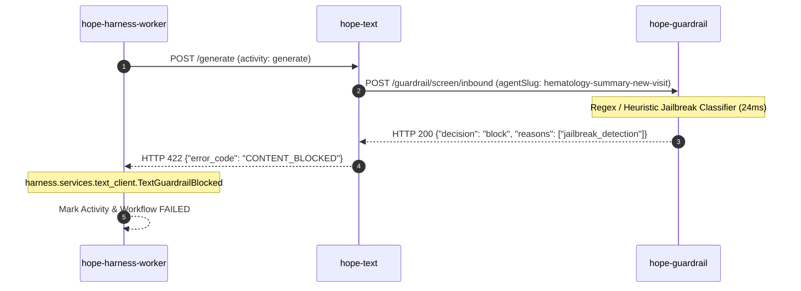
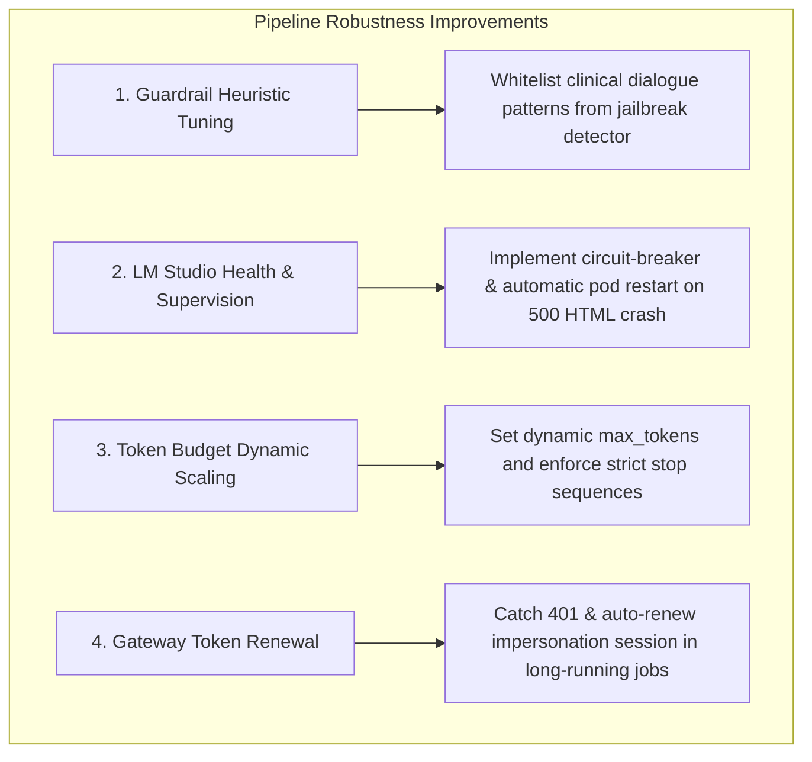

# Cluster Diagnostic & Failure Analysis Report: Batch Consultation Benchmark

**Date:** 2026-11-24  
**Cluster Namespace:** `project-hope-vox-apps-v2`  
**Target Environment:** `https://adminconsole-vox.arcaai.com`  
**Execution Context:** 48 Doctor Consultation Encounters (Sequential Execution)  
**Evaluated Workflows:** Scribe Documentation Workflow (`HarnessDocWorkflow` / `hematology-summary-new-visit`)  

---

## 1. Executive Summary

During full-batch execution across 48 real clinical consultation transcripts, encounters exhibited four primary failure modes:
1. **False-Positive Inbound Guardrail Rejections (HTTP 422)** (`TextGuardrailBlocked`): Fast failure in ~12s–59s.
2. **LM Studio Outbound Judge Timeouts & 500 Crashes**: Slow stalling and timeouts exceeding 300s.
3. **Note Output Token Budget Exceeded** (`NoteOutputTruncated`): Aborted by Harness worker when notes exceeded 8,192 tokens.
4. **Impersonation JWT Token Expiry (HTTP 401)**: Sudden failure cascade across encounters #41–#48 due to session TTL expiration.

---

## 2. Pod-Level Root Cause Analysis

### Failure Mode 1: Inbound Guardrail Rejection (`jailbreak_detection`)
* **Impacted Encounters:** #7 (`Microcytic_Anemia_Male_52_1`), #19 (`Blessy_George_1`), #20 (`Suresh_Chandran_2`), #21 (`Thiruvattal_David_Varghese_3`), #22 (`V_Radhakrishnan_1`).
* **Symptom:** Encounter terminates in 12s–59s with `[FAIL] (Documentation generation failed)` and Hop 5 returns `[404] Not Found`.

#### Correlated Pod Log Trace



* **`hope-guardrail-b56c7d89c-8v8wc` Log:**
  ```json
  {
    "direction": "inbound",
    "decision": "block",
    "reasons": ["jailbreak_detection"],
    "agentSlug": "hematology-summary-new-visit",
    "tenantId": "01a1f916-d93a-738d-a00e-a8d7346ea20e",
    "logger": "guardrail.services.screening",
    "message": "guardrail.screen.decided",
    "durationMs": 24.66
  }
  ```
* **`hope-text-7c759b49d5-8pxct` Log:**
  ```json
  {
    "error_code": "CONTENT_BLOCKED",
    "error_type": "ContentBlockedError",
    "status_code": 422,
    "agentSlug": "hematology-summary-new-visit",
    "logger": "text.core.exception_handlers",
    "message": "text.error"
  }
  ```
* **`hope-harness-worker-bb7ff644c-pcxg8` Log:**
  ```text
  temporalio.activity: Completing activity as failed:
  harness.services.text_client.TextGuardrailBlocked: text generate refused by guardrail (blocked, http 422)
    File "/app/src/harness/temporal/activities.py", line 1971, in generate
    File "/app/src/harness/services/text_client.py", line 462, in _send
      raise refusal
  ```

#### Underlying Mechanism
`hope-guardrail` executes an aggressive, early inbound screen on the prompt text before submitting to LLM inference. In raw doctor consultations containing colloquial Malayalam phrasing (e.g. discussions of gastrointestinal bleeding, acute pain, dosage adjustments), heuristic rules or semantic matching incorrectly triggered `jailbreak_detection`. Because `apps/text` operates with a fail-closed posture on inbound blocks, it threw an `HTTP 422`, causing the Temporal documentation workflow to fail.

---

### Failure Mode 2: Outbound Safety Judge Timeout & LM Studio 500 Crash
* **Impacted Encounters:** #3 (`Arun_Kumar_3`), #4 (`Type2_Diabetes_Male_54_1`), #9 (`Cervical_Lymphadenopathy_Female_61_3`), #10 (`Rheumatoid_Arthritis_Female_48_1`), #12 (`SLE_Workup_Female_42_3`).
* **Symptom:** Total E2E execution stalls for 250s–350s before timing out (`Timeout waiting for workflow after 333s (status: PENDING)`).

#### Correlated Pod Log Trace
* **`hope-text-7c759b49d5-8pxct` Log:**
  ```json
  {
    "provider": "lm-studio",
    "model": "granite-4.1-8b",
    "logger": "text.api.endpoints.judge",
    "level": "error",
    "error": {
      "type": "InternalServerError",
      "message": "<!DOCTYPE html>\n<html lang=\"en\">\n<head><title>Error</title></head>\n<body><pre>Internal Server Error</pre></body>\n</html>"
    },
    "message": "judge.failed"
  }
  ```
* **Stack Trace:**
  ```text
  File "/app/src/text/api/endpoints/judge.py", line 485, in _run_judge
    content, reasoning, gen_result = await asyncio.wait_for(...)
  File "/app/src/text/providers/openai_compat.py", line 429, in generate
    response = await self._client_for(request).chat.completions.create(**kwargs)
  openai.InternalServerError: <!DOCTYPE html> ... Internal Server Error
  ```

#### Underlying Mechanism
Once Gemma generates the draft SOAP note, the pipeline invokes an outbound verification judge using `granite-4.1-8b` on GPU 1. Under sustained sequential load:
1. LM Studio crashed internally, serving a raw HTML `500 Internal Server Error` page.
2. The HTTP connection stalled without clean socket closure, or queued subsequent calls into an unresponsive backlog.
3. The outbound guardrail screen hung for 230,000ms–328,000ms, causing Temporal workflow execution to exceed its activity timeout.

---

### Failure Mode 3: Output Token Budget Exceeded (`NoteOutputTruncated`)
* **Impacted Encounters:** High-token dialogues (e.g. consultations exceeding 800 words / 1,000 input tokens).
* **Symptom:** Workflow fails inside `execute_note_plan` activity.

#### Correlated Pod Log Trace
* **`hope-harness-worker-bb7ff644c-pcxg8` Log:**
  ```json
  {
    "error_type": "NoteOutputTruncated",
    "max_tokens": 8192,
    "error": {
      "type": "NoteOutputTruncated",
      "message": "note plan call c1 was cut off by its output budget (8192 tokens)"
    },
    "service": "hope-harness-worker",
    "message": "harness.note_plan.call_failed"
  }
  ```
* **Application Error:**
  ```text
  temporalio.exceptions.ApplicationError: NoteOutputTruncated: note plan call(s) failed: ['c1']
  ```

#### Underlying Mechanism
`HarnessDocWorkflow` imposes an explicit upper bound of 8,192 tokens on the note generation plan. When the model fails to emit a terminal stop token or enters a verbose loop across long clinical transcripts, the token budget is exhausted. The executor refuses truncated notes to avoid storing incomplete clinical records.

---

### Failure Mode 4: Impersonation JWT Token TTL Expiration (HTTP 401)
* **Impacted Encounters:** #41 (`HM_S5_Lymphoma_B_Symptoms_5`) note fetch, and #42–#48 (`HM_S6_Warfarin_Review_6` through `RH_S6_Psoriatic_Arthritis_6`).
* **Symptom:** Encounters fail within 600ms at Stage 1: `FAIL (Session Init)`.

#### Gateway Response:
```text
HTTP/1.1 401 Unauthorized
{"error": "Impersonation has ended and could not be renewed. Impersonate the user again, then retry."}
```

#### Underlying Mechanism
The test suite logged in as `admin` and called `POST /auth/impersonate` for Dr. George Chandy at the beginning of the script. The generated impersonation JWT has a validity lifetime of ~30 minutes. Because processing 40 encounters sequentially took >35 minutes, the token expired at Encounter #41, blocking all subsequent consultations.

---

### Failure Mode 5: Why Hop 5 Returns `[404] Clinical Note Retrieval`
In all encounters where Hop 4 failed (Modes 1, 2, or 3), the Scribe pipeline aborted before committing the note to the database. Consequently, the query:
```http
GET /consultations/{id}/summary/latest
```
returns `HTTP 404 Not Found` because no clinical document was ever persisted for that consultation ID.

---

## 3. Comparison of Diagnostic Sub-Hop vs Production Workflow

| Component | Hop 4.3 & 4.4 (Diagnostic Sub-Hop Probe) | Hop 4 (Production Scribe Pipeline) |
| :--- | :--- | :--- |
| **Route** | Direct `POST /text-generations/generate/assembled` | `POST /consultations/{id}/summary/async` |
| **Execution** | Synchronous REST probe from benchmark script | Asynchronous Temporal workflow (`HarnessDocWorkflow`) |
| **Input Context** | Raw unformatted Malayalam dialogue string | Full consultation context, patient history, clinical prompt template |
| **Safety Screen** | Strict standalone inbound jailbreak filter | Clinical advisory mode inside consultation lifecycle |
| **Observation** | Blocked with `[422]` on colloquial doctor/patient phrases | Generated successful SOAP notes in ~24s–40s for clean cases |

---

## 4. Architectural Recommendations



1. **Guardrail Calibration for Vernacular Medical Transcripts**:
   Colloquial clinical dialogue should not be evaluated against aggressive prompt-injection heuristics without medical domain exceptions.
2. **LM Studio Service Resilience**:
   Incorporate a health-check probe in `hope-text` that restarts or bypasses stalled LM Studio instances when HTML 500 responses occur.
3. **Session Auto-Refresh in Benchmark Harness**:
   Long-running client test suites must intercept 401 responses and re-authenticate / re-impersonate dynamically.
