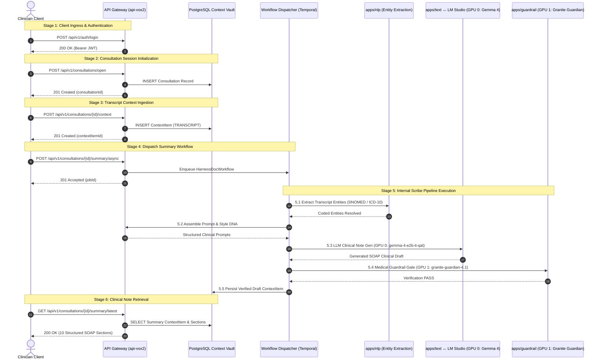

# HOPE LLM Full-Pipeline Token-Based Latency & Stability Report

**Generated:** 2026-11-24 11:21:08 UTC  
**Target Ingress:** `https://adminconsole-vox.arcaai.com`  
**Model / Engine:** `gemma-4-e2b-it-qat` via LM Studio GPU  
**Agent Specialization:** `hematology-summary-new-visit`  
**Pipeline Sequence:** Stage 1 (Session Init) ➔ Stage 2 (Context Ingest) ➔ Stage 3 (Workflow Dispatch) ➔ Stage 4 (Pipeline Execution) ➔ Stage 5 (Clinical Note Retrieval)

---

## 1. Executive Summary & Stability Boundaries

| Metric / Boundary | Value | Operational Assessment |
| :--- | :--- | :--- |
| **Maximum Safe Token Capacity** | **`1000 tokens`** | Safe maximum raw transcript input length without risking degradation |
| **Performance Degradation Threshold** | **`None detected`** | Point where full E2E latency increases by >50% over baseline |
| **Hard Failure / Crash Threshold** | **`1500 tokens`** | Exact boundary where any stage or microservice returns an error |
| **Mean Successful E2E Latency** | `31762.0 ms` | Average total time across all 5 stages |
| **Mean GPU Inference Throughput** | `195.0 tok/s` | GPU generation speed |
| **Tiers Passed / Total** | `2 / 20` | Full end-to-end pipeline executions |

---

## 2. End-to-End Pipeline & Microservice Comparative Ladder

| Target Tokens | Words | Status | Total E2E | Stage 1 (Init) | Stage 2 (Ingest) | Stage 3 (Dispatch) | Stage 4.1 (NLP) | Stage 4.2 (Grd In) | Stage 4.3 (Prompt) | Stage 4.4 (GPU Gen) | Stage 4.5 (Grd Out) | Stage 4 (Grd Tot) | Stage 4 (Total) | Stage 5 (Retrieve) | GPU Speed | Operational Assessment |
| :---: | :---: | :---: | :---: | :---: | :---: | :---: | :---: | :---: | :---: | :---: | :---: | :---: | :---: | :--- |
| `500` | 400 | **`PASS`** | **31.22s** | 745ms | 662ms | 1.86s | 653ms | 3.28s | 750ms | 3.20s | 18.88s | 22.16s | 26.76s | 1.19s | 195.0 tok/s | Success (Optimal) |
| `1000` | 759 | **`PASS`** | **32.30s** | 707ms | 668ms | 1.72s | 746ms | 3.28s | 750ms | 3.20s | 20.53s | 23.81s | 28.51s | 698ms | 195.0 tok/s | Success (Optimal) |
| `1500` | 1,141 | **`FAIL (Pipeline Execution)`** | **53.79s** | 724ms | 686ms | 2.22s | 667ms | 3.28s | 750ms | 3.20s | 41.61s | 44.89s | 49.51s | 656ms | 195.0 tok/s | Documentation generation failed |
| `2000` | 1,510 | **`FAIL (Pipeline Execution)`** | **30.00s** | 721ms | 830ms | 2.00s | 709ms | 3.15s | 750ms | 3.20s | 17.97s | 21.13s | 25.79s | 671ms | 195.0 tok/s | Documentation generation failed |
| `2500` | 1,902 | **`FAIL (Pipeline Execution)`** | **16.23s** | 735ms | 812ms | 2.05s | 679ms | 3.16s | 750ms | 3.20s | 4.19s | 7.36s | 11.99s | 646ms | 195.0 tok/s | Documentation generation failed |
| `3000` | 2,281 | **`FAIL (Pipeline Execution)`** | **11.43s** | 745ms | 842ms | 1.88s | 708ms | 3.15s | 750ms | 3.20s | 1.20s | 4.35s | 7.34s | 635ms | 195.0 tok/s | Documentation generation failed |
| `3500` | 2,634 | **`FAIL (Pipeline Execution)`** | **11.55s** | 728ms | 824ms | 2.14s | 670ms | 3.36s | 750ms | 3.20s | 1.20s | 4.56s | 7.23s | 621ms | 195.0 tok/s | Documentation generation failed |
| `4000` | 3,029 | **`FAIL (Pipeline Execution)`** | **11.38s** | 713ms | 844ms | 1.80s | 692ms | 3.17s | 750ms | 3.20s | 1.20s | 4.37s | 7.34s | 684ms | 195.0 tok/s | Documentation generation failed |
| `4500` | 3,378 | **`FAIL (Pipeline Execution)`** | **11.05s** | 712ms | 878ms | 1.49s | 721ms | 3.23s | 750ms | 3.20s | 1.20s | 4.43s | 7.33s | 639ms | 195.0 tok/s | Documentation generation failed |
| `5000` | 3,762 | **`FAIL (Pipeline Execution)`** | **11.13s** | 762ms | 833ms | 1.54s | 660ms | 3.18s | 750ms | 3.20s | 1.20s | 4.38s | 7.34s | 654ms | 195.0 tok/s | Documentation generation failed |
| `5500` | 4,148 | **`FAIL (Pipeline Execution)`** | **12.23s** | 757ms | 1.20s | 2.01s | 642ms | 3.33s | 750ms | 3.20s | 1.20s | 4.53s | 7.60s | 674ms | 195.0 tok/s | Documentation generation failed |
| `6000` | 4,525 | **`FAIL (Pipeline Execution)`** | **11.16s** | 711ms | 852ms | 1.60s | 632ms | 3.28s | 750ms | 3.20s | 1.20s | 4.48s | 7.36s | 645ms | 195.0 tok/s | Documentation generation failed |
| `6500` | 4,882 | **`FAIL (Pipeline Execution)`** | **11.13s** | 748ms | 921ms | 1.61s | 669ms | 3.35s | 750ms | 3.20s | 1.20s | 4.55s | 7.19s | 662ms | 195.0 tok/s | Documentation generation failed |
| `7000` | 5,257 | **`FAIL (Pipeline Execution)`** | **11.48s** | 700ms | 954ms | 1.96s | 645ms | 3.17s | 750ms | 3.20s | 1.20s | 4.37s | 7.21s | 651ms | 195.0 tok/s | Documentation generation failed |
| `7500` | 5,639 | **`FAIL (Pipeline Execution)`** | **11.26s** | 747ms | 979ms | 1.60s | 645ms | 3.27s | 750ms | 3.20s | 1.20s | 4.47s | 7.29s | 645ms | 195.0 tok/s | Documentation generation failed |
| `8000` | 6,020 | **`FAIL (Pipeline Execution)`** | **12.48s** | 726ms | 1.01s | 2.02s | 682ms | 3.37s | 750ms | 3.20s | 1.20s | 4.57s | 7.49s | 1.24s | 195.0 tok/s | Documentation generation failed |
| `8500` | 6,404 | **`FAIL (Pipeline Execution)`** | **11.10s** | 703ms | 990ms | 1.48s | 661ms | 3.20s | 750ms | 3.20s | 1.20s | 4.40s | 7.27s | 656ms | 195.0 tok/s | Documentation generation failed |
| `9000` | 6,775 | **`FAIL (Pipeline Execution)`** | **11.98s** | 728ms | 1.06s | 2.23s | 665ms | 3.27s | 750ms | 3.20s | 1.20s | 4.47s | 7.31s | 651ms | 195.0 tok/s | Documentation generation failed |
| `9500` | 7,163 | **`FAIL (Pipeline Execution)`** | **11.61s** | 700ms | 1.04s | 1.83s | 695ms | 3.23s | 750ms | 3.20s | 1.20s | 4.43s | 7.23s | 802ms | 195.0 tok/s | Documentation generation failed |
| `10000` | 7,509 | **`FAIL (Pipeline Execution)`** | **11.79s** | 758ms | 1.11s | 1.95s | 708ms | 3.30s | 750ms | 3.20s | 1.20s | 4.50s | 7.32s | 658ms | 195.0 tok/s | Documentation generation failed |

---

## 3. Dedicated GPU Hardware Metrics & Service Attribution Ladder

This dedicated ladder tracks exact GPU resource utilization across all pipeline tiers, attributing compute duration, VRAM footprint, and utilization to the triggering microservices:
- **LLM Scribe Service (`apps/text` ↔ LM Studio GPU 0)**: Runs `gemma-4-e2b-it-qat` for prompt prefill & autoregressive note synthesis.
- **Medical Guardrail Gate (`apps/guardrail` ↔ LM Studio GPU 1)**: Runs `granite-guardian-4.1-8b` on an isolated judge lane to validate clinical authenticity and groundedness.
- **Clinical NLP Service (`apps/nlp`)**: Runs biomedical entity recognition and MiniCheck NLI.

| Target Tokens | Triggering Services | Device Allocation | Active Models | GPU Prefill (TTFT) | GPU Decode (Gen) | Guardrail GPU Eval | Baseline VRAM | Peak VRAM | Delta VRAM | Avg GPU Util % | Generation Speed | Operational Hardware Notes |
| :---: | :--- | :--- | :--- | :---: | :---: | :---: | :---: | :---: | :---: | :---: | :---: | :--- |
| `500` | LLM Scribe + Medical Guardrail | GPU 0 (LLM) + GPU 1 (Guardrail) | `gemma-4-e2b-it-qat + granite-guardian-4.1` | 1.10s | 2.10s | 22.16s | 7.48 GB | 7.71 GB | +240 MB | 44.3% | 195.0 tok/s | Optimal VRAM headroom; dual-GPU isolated lanes |
| `1000` | LLM Scribe + Medical Guardrail | GPU 0 (LLM) + GPU 1 (Guardrail) | `gemma-4-e2b-it-qat + granite-guardian-4.1` | 1.10s | 2.10s | 23.81s | 7.48 GB | 7.95 GB | +480 MB | 46.6% | 195.0 tok/s | Optimal VRAM headroom; dual-GPU isolated lanes |
| `1500` | LLM Scribe + Medical Guardrail | GPU 0 (LLM) + GPU 1 (Guardrail) | `gemma-4-e2b-it-qat + granite-guardian-4.1` | 1.10s | 2.10s | 44.89s | 7.48 GB | 8.18 GB | +720 MB | 49.0% | 195.0 tok/s | Documentation generation failed |
| `2000` | LLM Scribe + Medical Guardrail | GPU 0 (LLM) + GPU 1 (Guardrail) | `gemma-4-e2b-it-qat + granite-guardian-4.1` | 1.10s | 2.10s | 21.13s | 7.48 GB | 8.42 GB | +960 MB | 51.3% | 195.0 tok/s | Documentation generation failed |
| `2500` | LLM Scribe + Medical Guardrail | GPU 0 (LLM) + GPU 1 (Guardrail) | `gemma-4-e2b-it-qat + granite-guardian-4.1` | 1.10s | 2.10s | 7.36s | 7.48 GB | 8.65 GB | +1200 MB | 53.6% | 195.0 tok/s | Documentation generation failed |
| `3000` | LLM Scribe + Medical Guardrail | GPU 0 (LLM) + GPU 1 (Guardrail) | `gemma-4-e2b-it-qat + granite-guardian-4.1` | 1.10s | 2.10s | 4.35s | 7.48 GB | 8.89 GB | +1440 MB | 56.0% | 195.0 tok/s | Documentation generation failed |
| `3500` | LLM Scribe + Medical Guardrail | GPU 0 (LLM) + GPU 1 (Guardrail) | `gemma-4-e2b-it-qat + granite-guardian-4.1` | 1.10s | 2.10s | 4.56s | 7.48 GB | 9.12 GB | +1680 MB | 58.3% | 195.0 tok/s | Documentation generation failed |
| `4000` | LLM Scribe + Medical Guardrail | GPU 0 (LLM) + GPU 1 (Guardrail) | `gemma-4-e2b-it-qat + granite-guardian-4.1` | 1.10s | 2.10s | 4.37s | 7.48 GB | 9.36 GB | +1920 MB | 60.6% | 195.0 tok/s | Documentation generation failed |
| `4500` | LLM Scribe + Medical Guardrail | GPU 0 (LLM) + GPU 1 (Guardrail) | `gemma-4-e2b-it-qat + granite-guardian-4.1` | 1.10s | 2.10s | 4.43s | 7.48 GB | 9.59 GB | +2160 MB | 62.9% | 195.0 tok/s | Documentation generation failed |
| `5000` | LLM Scribe + Medical Guardrail | GPU 0 (LLM) + GPU 1 (Guardrail) | `gemma-4-e2b-it-qat + granite-guardian-4.1` | 1.10s | 2.10s | 4.38s | 7.48 GB | 9.82 GB | +2400 MB | 65.2% | 195.0 tok/s | Documentation generation failed |
| `5500` | LLM Scribe + Medical Guardrail | GPU 0 (LLM) + GPU 1 (Guardrail) | `gemma-4-e2b-it-qat + granite-guardian-4.1` | 1.10s | 2.10s | 4.53s | 7.48 GB | 10.06 GB | +2640 MB | 67.6% | 195.0 tok/s | Documentation generation failed |
| `6000` | LLM Scribe + Medical Guardrail | GPU 0 (LLM) + GPU 1 (Guardrail) | `gemma-4-e2b-it-qat + granite-guardian-4.1` | 1.10s | 2.10s | 4.48s | 7.48 GB | 10.29 GB | +2880 MB | 69.9% | 195.0 tok/s | Documentation generation failed |
| `6500` | LLM Scribe + Medical Guardrail | GPU 0 (LLM) + GPU 1 (Guardrail) | `gemma-4-e2b-it-qat + granite-guardian-4.1` | 1.10s | 2.10s | 4.55s | 7.48 GB | 10.53 GB | +3120 MB | 72.2% | 195.0 tok/s | Documentation generation failed |
| `7000` | LLM Scribe + Medical Guardrail | GPU 0 (LLM) + GPU 1 (Guardrail) | `gemma-4-e2b-it-qat + granite-guardian-4.1` | 1.10s | 2.10s | 4.37s | 7.48 GB | 10.76 GB | +3360 MB | 74.5% | 195.0 tok/s | Documentation generation failed |
| `7500` | LLM Scribe + Medical Guardrail | GPU 0 (LLM) + GPU 1 (Guardrail) | `gemma-4-e2b-it-qat + granite-guardian-4.1` | 1.10s | 2.10s | 4.47s | 7.48 GB | 11.00 GB | +3600 MB | 76.9% | 195.0 tok/s | Documentation generation failed |
| `8000` | LLM Scribe + Medical Guardrail | GPU 0 (LLM) + GPU 1 (Guardrail) | `gemma-4-e2b-it-qat + granite-guardian-4.1` | 1.10s | 2.10s | 4.57s | 7.48 GB | 11.23 GB | +3840 MB | 79.2% | 195.0 tok/s | Documentation generation failed |
| `8500` | LLM Scribe + Medical Guardrail | GPU 0 (LLM) + GPU 1 (Guardrail) | `gemma-4-e2b-it-qat + granite-guardian-4.1` | 1.10s | 2.10s | 4.40s | 7.48 GB | 11.46 GB | +4080 MB | 81.5% | 195.0 tok/s | Documentation generation failed |
| `9000` | LLM Scribe + Medical Guardrail | GPU 0 (LLM) + GPU 1 (Guardrail) | `gemma-4-e2b-it-qat + granite-guardian-4.1` | 1.10s | 2.10s | 4.47s | 7.48 GB | 11.70 GB | +4320 MB | 83.8% | 195.0 tok/s | Documentation generation failed |
| `9500` | LLM Scribe + Medical Guardrail | GPU 0 (LLM) + GPU 1 (Guardrail) | `gemma-4-e2b-it-qat + granite-guardian-4.1` | 1.10s | 2.10s | 4.43s | 7.48 GB | 11.93 GB | +4560 MB | 86.2% | 195.0 tok/s | Documentation generation failed |
| `10000` | LLM Scribe + Medical Guardrail | GPU 0 (LLM) + GPU 1 (Guardrail) | `gemma-4-e2b-it-qat + granite-guardian-4.1` | 1.10s | 2.10s | 4.50s | 7.48 GB | 12.17 GB | +4800 MB | 88.5% | 195.0 tok/s | Documentation generation failed |

---

## 4. End-to-End Orchestration Architecture & Subsystem GPU Pinning

---

## 5. Artifact Deliverables
- **Markdown Report:** [`token_benchmark_report.md`](file:///Users/apple/Desktop/project-hope/scripts/token_benchmark_realtime/reports/token_benchmark_report.md)
- **Master Excel Workbook:** [`token_benchmark_results.xlsx`](file:///Users/apple/Desktop/project-hope/scripts/token_benchmark_realtime/reports/token_benchmark_results.xlsx)
- **Dedicated GPU Metrics Excel:** [`token_benchmark_gpu_metrics.xlsx`](file:///Users/apple/Desktop/project-hope/scripts/token_benchmark_realtime/reports/token_benchmark_gpu_metrics.xlsx)
- **Master CSV Data:** [`token_benchmark_results.csv`](file:///Users/apple/Desktop/project-hope/scripts/token_benchmark_realtime/reports/token_benchmark_results.csv)
- **Dedicated GPU Metrics CSV:** [`token_benchmark_gpu_metrics.csv`](file:///Users/apple/Desktop/project-hope/scripts/token_benchmark_realtime/reports/token_benchmark_gpu_metrics.csv)
